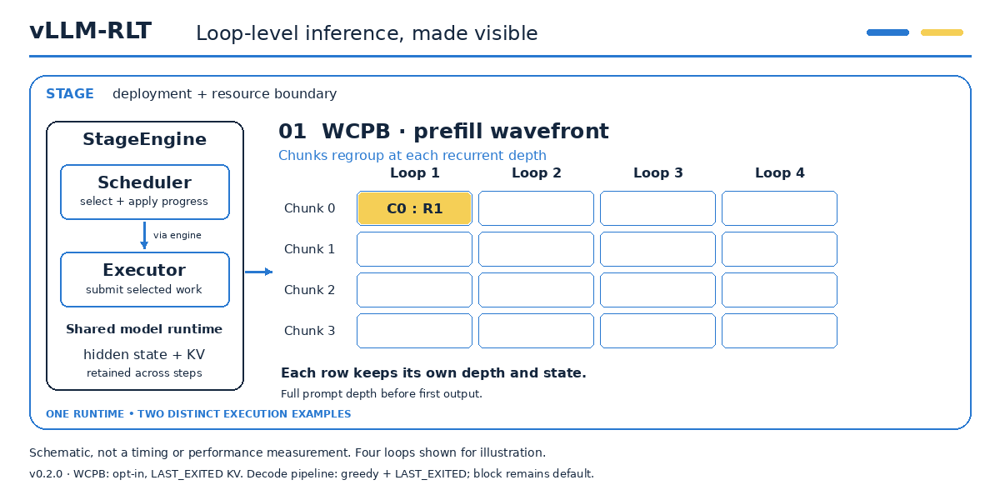

<h1 align="center">
  
</h1>

<p align="center">
  <a href="https://arxiv.org/abs/2608.09444"></a>
  <a href="LICENSE"></a>
  <a href="pyproject.toml"></a>
  <a href="#contributing"></a>
</p>

<p align="center">
  <strong>Loop-level continuous batching for recurrent language models.</strong>
</p>

<p align="center">
  <a href="docs/README.md"><b>Documentation</b></a> ·
  <a href="#getting-started"><b>Getting Started</b></a> ·
  <a href="#model-support"><b>Supported Models</b></a> ·
  <a href="docs/developer-guide.md"><b>Developer Guide</b></a> ·
  <a href="https://github.com/InferMatrixLab/vllm-rlt/releases"><b>Releases</b></a> ·
  <a href="#join-the-community"><b>Community</b></a> ·
  <a href="https://arxiv.org/abs/2608.09444"><b>CDB Paper</b></a>
</p>

---

<a id="whats-new-in-v020"></a>

## Latest News

- **2026/11 — [v0.2.0](https://github.com/InferMatrixLab/vllm-rlt/releases/tag/v0.2.0)**:
  core runtime refactoring around Stage and Loop, wavefront chunked prefill
  (WCPB), and experimental token-level decode pipelining. See the
  [changelog](CHANGELOG.md) for model additions, migration notes, and validation scope.

---

## About

**vllm-rlt** is a standalone inference and serving engine for **recurrent
language models**. It schedules individual recurrent loops, allowing requests
at different depths to share a batch instead of waiting for an entire cohort
to finish. Its engine organization is inspired by vLLM, but it runs independently
and does not require vLLM to be installed.

<a id="highlights"></a>
<a id="how-it-works"></a>

### One runtime, pipelined work

- **Stage/Loop architecture.** A stage owns deployment and resources; a loop
  is a stage-local execution and scheduling unit. Scheduler selects work and
  applies results; Executor submits execution. Prefill and decode share this
  runtime structure.
- **WCPB prefill.** Wavefront chunked prefill exposes loop boundaries so prompt
  chunks can advance at different recurrent depths. Compatible non-speculative
  prefill and decode work can share a batch.
- **Decode pipeline.** Experimental token-level self-speculation advances
  different tokens at different loop depths while retaining hidden states.
  Asynchronous execution separates device progress from CPU output delivery.

<p align="center">
  <picture>
    <source media="(prefers-reduced-motion: reduce)" srcset="docs/assets/rlt-loop-pipelines.png">
    
  </picture>
</p>

*Original conceptual animation, not a benchmark or a claim that every mode can
be combined. [Static illustration](docs/assets/rlt-loop-pipelines.png) ·
[Animation source](docs/assets/runtime/README.md) ·
[Architecture](docs/unified_execution.md) ·
[WCPB](docs/split-prefill-wavefront.md) ·
[Decode pipeline](docs/async-speculative.md).*

Prefill and decode provide complementary pipelined execution paths, connected
through separate PD stages and KV transfer in supported configurations. PD is
currently **same-host CUDA** with supported Triton/FA4 paths; it is not a claim
of universal multi-node or model support. Speculative steps are not included
in mixed prefill/decode batches.


<a id="features"></a>


### Designed for recurrent inference

- **Depth-aware paged KV cache:** LAST_EXITED and SHARED layouts, with optional
  prefix reuse, incremental allocation, priorities and preemption.
- **Adaptive computation:** fixed-depth inference or Ouro's trained early-exit
  gate, with per-request loop bounds. Changing exit policy can change quality.
- **Configurable execution:** Torch reference execution, GPU attention backends,
  CUDA Graphs, and optional asynchronous/speculative paths. An optional native
  CUDA SiLU-and-Mul operator accelerates the Ouro activation path, with a Torch
  fallback; it is not a general model-speedup claim.
- **Sparse decode reference integration (opt-in):** cached loop-2 attention
  correction for ordinary decode and block self-speculation, with shared
  per-token reference ownership and explicit capability limits; see the
  [configuration and scope](docs/runtime.md#sparse-decode-attention-reference-path).
- **Offline and online use:** Python API, CLI, and a streaming
  OpenAI-compatible **completions** endpoint. This is not a chat-completions API.

> [!IMPORTANT]
> **v0.2.0 is a research/evaluation milestone.** Default execution is synchronous;
> advanced modes are opt-in and have model-specific constraints. Token-pipeline
> speculation is experimental. Historical serving measurements have unresolved
> cross-configuration output-equivalence differences, so they are diagnostic,
> not equal-quality speedup or production-readiness claims.

## Getting Started

Requires **Python 3.10+** and **PyTorch 2.5+**. For GPU inference, use Linux and
an NVIDIA GPU with a compatible CUDA-enabled PyTorch installation.

```bash
# Activate your Python environment first.
git clone --branch v0.2.0 --depth 1 https://github.com/InferMatrixLab/vllm-rlt.git
cd vllm-rlt
uv pip install -e .
vllm-rlt-serve --help
```

This installs text, serving and Linux Triton dependencies. Standard isolated
builds use the Torch activation fallback; optional native CUDA compilation
requires a compatible toolchain. Model weights are downloaded separately.
No PyPI publication is implied.

- [Installation and first request](docs/launching.md)
- [Python API and CLI](docs/launching.md)
- [HTTP serving and streaming](docs/serving.md) — use a trusted network or secure
  gateway; the server has no built-in authentication or TLS.
- [Supported models](#model-support) and [Ouro-Thinking recipe](docs/recipes/ouro_thinking.md)
- [Configuration and compatibility](docs/runtime.md)
- [Native CUDA build](docs/launching.md#automatic-native-cuda-build)
- [Migration from v0.1.0](CHANGELOG.md)

## Model Support


| Checkpoint | Implementation | Documented validation scope | Guide |
| --- | --- | --- | --- |
| Ouro-1.4B | Native Ouro | Existing runtime and benchmark coverage under their recorded configurations | [Runtime](docs/runtime.md), [accuracy](docs/accuracy.md) |
| Ouro-2.6B | Shared Ouro | Shares the Ouro implementation; not separately qualified, and 1.4B quality/performance results are not inherited | [Scope notes](docs/recipes/ouro_thinking.md#6-evidence-and-limitations) |
| Ouro-1.4B-Thinking | Reuses Ouro | Bounded BF16, fixed-four-loop synchronous basic integration | [Shared recipe](docs/recipes/ouro_thinking.md) |
| Ouro-2.6B-Thinking | Reuses Ouro | Bounded BF16, fixed-four-loop synchronous basic integration | [Shared recipe](docs/recipes/ouro_thinking.md) |
| Nanbeige4.2-3B | Native Nanbeige | Fixed two-loop inference | [Runtime](docs/runtime.md) |
| Huginn-0125 | Native Huginn | Synchronous fixed-depth, LAST_EXITED KV, CUDA Graph decode core and coda | [Runtime](docs/runtime.md) |

Shared implementation does not qualify every checkpoint/feature combination;
see the linked guides for validation scope and limitations. See
[RFC #69](https://github.com/InferMatrixLab/vllm-rlt/issues/69) for the broader roadmap.

Huginn uses native checkpoint loading and depth-aware KV for its recurrent
core, with separate prelude and coda KV. It supports synchronous fixed-depth
inference and CUDA Graphs for the recurrent core and decode coda.

Huginn does **not** currently support WCPB/mixed staged prefill, asynchronous
execution, self-speculation, or PD. Feature availability is not equivalent to
validation of every model/backend/workload combination.

## Documentation

Start with the [documentation index](docs/README.md), then explore:

| Topic | Guide |
| --- | --- |
| Runtime and process boundaries | [Unified architecture](docs/unified_execution.md) |
| Chunk/depth scheduling | [WCPB prefill](docs/split-prefill-wavefront.md) |
| Asynchronous block execution and token pipelines | [Self-speculation](docs/async-speculative.md) |
| Cache ownership and lifetime | [KV walkthrough](docs/kv_cache_walkthrough.md) |
| Evaluation and measurement | [Accuracy](docs/accuracy.md), [profiling](docs/profiling.md) |

<a id="performance-baselines"></a>

**Performance evidence:** the [October 2026 serving report](docs/unified_execution.md#measured-serving-performance)
records Ouro-1.4B BF16 on B300/FA4, workloads, one- versus two-GPU configurations,
metric definitions and limitations. Compare matched hardware, workload and
quality; do not interpret unequal resource budgets or differing output lengths
as isolated runtime speedups.

<a id="roadmap"></a>

For ongoing design work, see the [architecture RFC](https://github.com/InferMatrixLab/vllm-rlt/issues/32)
and [model roadmap](https://github.com/InferMatrixLab/vllm-rlt/issues/69).
Roadmap proposals are not released capabilities.

## Contributing

We welcome systems, model, evaluation and documentation contributions.
Read [CONTRIBUTING.md](CONTRIBUTING.md) and the
**[Developer Must-Read](docs/developer-guide.md)** before implementation.
Include reproducible configurations, correctness evidence and the scope of
any measurements. For larger changes, start with a design issue.

## Citation


For the CDB method that informs this project, please cite the original paper:
[Depth-adaptive Inference of Looped Language Models via Continuous Depth
Batching](https://arxiv.org/abs/2608.09444)
([PDF](https://arxiv.org/pdf/2608.09444)).

```bibtex
@misc{schwethelm2026continuousdepthbatching,
  title = {Depth-adaptive Inference of Looped Language Models via Continuous Depth Batching},
  author = {Kristian Schwethelm and Daniel R\"{u}ckert and Georgios Kaissis},
  year = {2026},
  eprint = {2608.09444},
  archivePrefix = {arXiv},
  primaryClass = {cs.LG},
  url = {https://arxiv.org/abs/2608.09444}
}
```

The paper's measurements are separate from the vllm-rlt performance baselines
linked above.

## Join the Community

Ask questions, report reproducible problems or discuss designs in
[GitHub issues](https://github.com/InferMatrixLab/vllm-rlt/issues).
You can also join the existing vllm-rlt developer group through WeChat:

<p align="center">
  <a href="docs/assets/wechat-group-qrcode.jpg">
    
  </a>
</p>

## Acknowledgments

vllm-rlt builds on the published Ouro architecture and
[Continuous Depth Batching](https://arxiv.org/abs/2608.09444). Its engine and
Python API organization are inspired by [vLLM](https://github.com/vllm-project/vllm).
See [NOTICE](NOTICE) for upstream model attribution.

## License

[Apache License 2.0](LICENSE). Model checkpoints retain their own licenses and
usage conditions.
