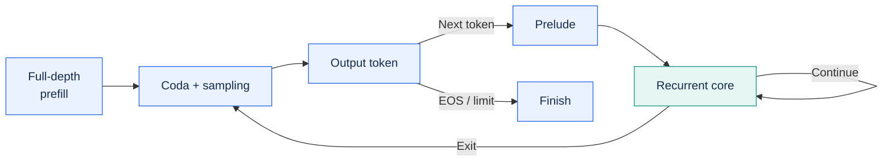
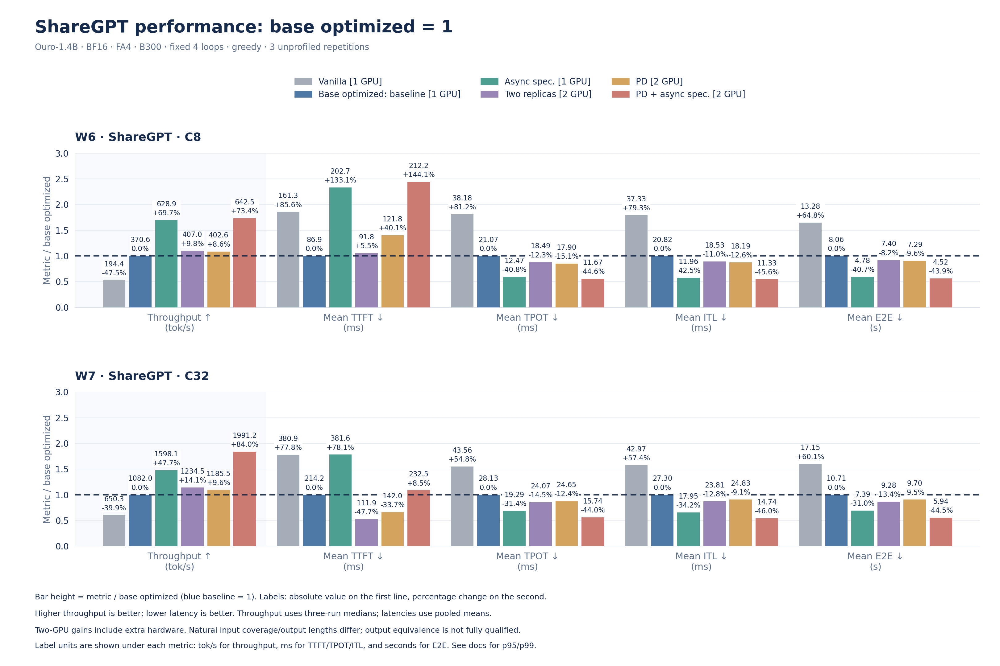

<h1 align="center">
  
</h1>

<p align="center">
  <a href="https://arxiv.org/abs/2608.09444"></a>
  <a href="LICENSE"></a>
  <a href="pyproject.toml"></a>
  <a href="#contributing"></a>
</p>

<p align="center">
  <strong>Loop-level continuous batching for recurrent language models.</strong>
</p>

<p align="center">
  <a href="https://arxiv.org/pdf/2608.09444">Paper</a> ·
  <a href="#highlights">Highlights</a> ·
  <a href="#how-it-works">How It Works</a> ·
  <a href="#getting-started">Getting Started</a> ·
  <a href="docs/README.md">Documentation</a> ·
  <a href="docs/developer-guide.md"><strong>Developer Must-Read</strong></a> ·
  <a href="#performance-baselines">Performance</a> ·
  <a href="#roadmap">Roadmap</a> ·
  <a href="#contributing">Contributing</a>
</p>

> [!IMPORTANT]
> **Contributing? Read the [Developer Must-Read](docs/developer-guide.md) first.**
> Good code starts before coding. Follow the development workflow and completion criteria before marking your change ready.

## About

**vllm-rlt** is a standalone inference and serving engine for recurrent language
models, with native support for **ByteDance/Ouro-1.4B** and
**Nanbeige/Nanbeige4.2-3B**, plus **tomg-group-umd/huginn-0125**. See the checkpoint-specific
[support matrix](#model-support) for validation scope. It brings continuous
batching to individual recurrent loops, allowing requests at different loop
depths to share a batch as they work toward their next token.

Recurrent models reuse a shared transformer core multiple times per token.
With adaptive early exit, different tokens can require different amounts of
computation. vllm-rlt schedules work at these loop boundaries and manages KV
state by recurrence depth, so requests can leave and refill the batch without
waiting for an entire cohort to finish.

The project follows a vLLM-style engine organization and implements runtime
ideas from **Continuous Depth Batching (CDB)**, described in
[Depth-adaptive Inference of Looped Language Models via Continuous Depth
Batching](https://arxiv.org/pdf/2608.09444) by Kristian Schwethelm, Daniel
Rückert, and Georgios Kaissis (2026). It runs independently and does not require
vLLM to be installed. See [Citation](#citation) for the paper's BibTeX entry.

## Highlights

- **Three native models:** Ouro-1.4B with fixed-depth or learned early-exit
  decoding, Nanbeige4.2-3B with fixed two-loop inference, and Huginn-0125 with
  synchronous fixed-depth inference.
- **Measured serving performance:** on the B300 ShareGPT C8 workload below,
  single-GPU asynchronous self-speculation reached **628.9 output tokens/s**,
  versus **370.6 tokens/s** with base optimizations (**+69.7%**). Mean completion
  latency fell **40.7%**; TTFT and ITL tails increased. These are diagnostic
  measurements with unresolved output-equivalence differences.
- **Loop-aware runtime:** continuous batching, depth-aware paged KV, and opt-in
  prefix caching, CUDA Graphs, self-speculation, and single-host prefill/decode
  disaggregation.
- **Ready-to-use interfaces:** Python API, CLI, and streaming OpenAI-compatible
  completions.

**[v0.1.0 is experimental](https://github.com/InferMatrixLab/vllm-rlt/releases/tag/v0.1.0).**
Start with synchronous execution. Async execution with preemption can produce
incorrect outputs ([#109](https://github.com/InferMatrixLab/vllm-rlt/pull/109));
async self-speculation has unresolved worker-failure and cleanup issues
([#115](https://github.com/InferMatrixLab/vllm-rlt/pull/115)). See the release notes
for supported combinations and limitations.

## Features

- **Loop-level continuous batching.** Mix requests at different recurrence
  depths, with refill and no-refill scheduling, chunked prefill, dynamic
  arrivals, and cancellation.
- **Adaptive computation.** Run fixed-depth decoding or use Ouro's trained
  early-exit gate, with per-request loop bounds and exit thresholds.
- **Depth-aware paged KV cache.** LAST-EXITED and SHARED layouts, automatic
  CUDA cache sizing, and optional prefix caching, incremental page allocation,
  priority scheduling, and preemption with CPU state snapshots.
- **Configurable GPU execution.** Triton and FlashAttention backends, asynchronous
  scheduling, multiple CUDA streams, reusable buffers, and CUDA Graph capture
  of decode recurrent cores. Asynchronous self-speculation also supports compatible
  paged FlashAttention backends and recurrent/coda CUDA Graphs; see the
  [execution scope and constraints](docs/async-speculative.md#cuda-graph-scope-and-ownership).
- **Offline and online inference.** A Python API, a command-line interface,
  and an OpenAI-compatible completions endpoint with streaming, greedy decoding,
  and seeded top-k/top-p sampling.
- **Prefill/decode disaggregation.** Separate prefill and decode worker pools
  across GPUs on one host, with NIXL KV transfer and overlap between chunked
  prefill computation and transfer.

The default runtime uses synchronous execution; Ouro uses its original gate.
Advanced execution and cache features are opt-in; see the guides below for
supported combinations.

An [experimental deferred Ouro runner](docs/recipes/ouro_deferred.md) groups deep
loops across response positions with true per-loop KV. It provides a standalone
mixed-readout experiment and an eager same-readout reference; real-weight BF16
quality, memory and speed qualification are still required.

## Model Support

| Checkpoint | Implementation | Documented validation scope | Guide |
| --- | --- | --- | --- |
| Ouro-1.4B | Native Ouro | Existing runtime and benchmark coverage under their recorded configurations | [Runtime](docs/runtime.md), [accuracy](docs/accuracy.md) |
| Ouro-2.6B | Shared Ouro | Shares the Ouro implementation; not separately qualified, and 1.4B quality/performance results are not inherited | [Scope notes](docs/recipes/ouro_thinking.md#6-evidence-and-limitations) |
| Ouro-1.4B-Thinking | Reuses Ouro | Bounded BF16, fixed-four-loop synchronous basic integration | [Shared recipe](docs/recipes/ouro_thinking.md) |
| Ouro-2.6B-Thinking | Reuses Ouro | Bounded BF16, fixed-four-loop synchronous basic integration | [Shared recipe](docs/recipes/ouro_thinking.md) |
| Nanbeige4.2-3B | Native Nanbeige | Fixed two-loop inference | [Runtime](docs/runtime.md) |
| Huginn-0125 | Native Huginn | Synchronous fixed-depth, LAST_EXITED KV, CUDA Graph decode core and coda | [Runtime](docs/runtime.md) |

Shared implementation does not qualify every checkpoint/feature combination;
see the linked guides for validation scope and limitations. See
[RFC #69](https://github.com/InferMatrixLab/vllm-rlt/issues/69) for the broader roadmap.

Huginn uses native checkpoint loading and depth-aware KV for its recurrent
core, with separate prelude and coda KV. It supports synchronous fixed-depth
inference and CUDA Graphs for the recurrent core and decode coda.

## How It Works

Prompt tokens traverse the full recurrent depth before the coda produces the
first output. With atomic prefill, a chunk's loops run in one submission; split
prefill exposes loop boundaries for scheduling and compatible prefill/decode
mixed batches. Each subsequent token passes through prelude, recurrence and
coda. The diagram below illustrates the atomic-prefill path.



**Stage is the deployment and resource boundary; loop is the unit of execution
and scheduling within a stage.** Prefill, decode and prefill_decode stages share one
execution architecture.

See the [architecture and flow diagrams](docs/unified_execution.md) and the
[runtime guide](docs/runtime.md) for implementation details and supported
configurations.

<a href="docs/assets/inference/ouro-inference.mp4">
  <picture>
    <source media="(prefers-reduced-motion: reduce)" srcset="docs/assets/inference/ouro-inference.png">
    
  </picture>
</a>

The animation follows one request: four-loop prefill produces `y₀`, then
processing `y₀` with a two-loop adaptive exit produces `y₁`. Each loop reuses
the same 24-layer transformer core. Gate scores and timing are illustrative;
the default `exit_threshold=1.0` uses four loops.
[Watch the MP4](docs/assets/inference/ouro-inference.mp4) for smoother playback.

## Getting Started

Requires **Python 3.10+** and **PyTorch 2.5+**. For GPU inference, use Linux with
an NVIDIA GPU and a CUDA-enabled PyTorch installation compatible with your
hardware.

With your environment activated, use uv from the repository root to install
the project (text, serving, and Triton
support are included):

```bash
uv pip install -e .
```

For a fresh machine, follow the [step-by-step user guide](docs/launching.md):
create an environment, download the model, start the server, and send your first
request. The guide also covers command-line inference and the Python API. Browse the [documentation](docs/README.md) for runtime
configuration, optional backends, and design notes.

## Performance Baselines

The figure below shows the October 2026 serving campaign on **Ouro-1.4B BF16,
NVIDIA B300, FlashAttention 4**, fixed four loops and greedy decoding. It covers
ShareGPT at closed-loop concurrency 8 and 32, with natural EOS and an output
cap of 512 tokens. The legend explicitly identifies each configuration's GPU count.



[Full-size PNG](docs/assets/performance/core-overview.png) ·
[All workloads, mean/p95/p99 latency and analysis](docs/unified_execution.md#measured-serving-performance)

**Reading the comparisons.** **Base optimized is the baseline for every metric
and is always plotted at 1**, shown by blue bars and a dashed line. Each colored
bar is the candidate's value divided by the base-optimized value for the same
metric and workload. **Above 1 is better for throughput; below 1 is better for
latency.** A throughput ratio of 1.7 means 70% higher throughput; a latency ratio
of 0.6 means 40% lower latency. Each bar label shows the **absolute value on
the first line and percentage change on the second**. Units appear below each
metric: tok/s for throughput, ms for TTFT/TPOT/ITL, and seconds for E2E. Baseline
bars also show their absolute values, with 0.0% change. **Vanilla** is the
unoptimized configuration and is included alongside the optimized modes, using
the same base-optimized denominator.

Two replicas means two independent base-optimized servers, each handling half
the total concurrency. PD uses one prefill GPU and one decode GPU. Their gains
against the single-GPU baseline include the additional hardware; see the
[per-GPU results](docs/unified_execution.md#two-gpu-resource-efficiency).

Throughput uses the median of three 60-second admission-plus-drain measurements.
TTFT, TPOT and E2E use pooled request means; ITL uses the pooled mean of client
token-arrival intervals, including zero intervals within each received chunk.
All workloads and latency p95/p99 are in the detailed report. All selected windows ran without profiling or new CUDA Graph captures.

At C8, single-GPU speculation improves throughput by **69.7%** over base
optimized and reduces mean E2E by **40.7%**. At C32, two-GPU PD + speculation
reaches **1,991.2 output tokens/s**, **84.0%** above the single-GPU base, with
mean E2E **44.5%** lower. Additional hardware does not guarantee proportional
throughput: at C8, PD + speculation is only slightly faster than single-GPU
speculation. Two speculative replicas were not measured.

**Scope and validation.** TTFT and token-interval tails can worsen even when
mean completion time improves. Natural input coverage and output lengths differ
between configurations, and full greedy output equivalence has not passed
across all modes. These are diagnostic serving measurements, not equal-quality
speedup claims or a production qualification. The complete campaign includes
26 combinations, 78 selected runs and 12,288 successful requests with no request
failures; configuration, provenance and metric definitions are in the
[detailed report](docs/unified_execution.md#measured-serving-performance).

Earlier measurements remain available in
[PR #30](https://github.com/InferMatrixLab/vllm-rlt/pull/30) and
[PR #31](https://github.com/InferMatrixLab/vllm-rlt/pull/31); their workloads and timing
boundaries differ from this campaign. See the [GSM8K evaluation guide](docs/accuracy.md)
for task-quality evaluation.

## Roadmap

We are refactoring module boundaries and state ownership while preserving
loop-level scheduling and KV semantics. See [RFC #32](https://github.com/InferMatrixLab/vllm-rlt/issues/32)
for the target architecture, module breakdown, and implementation sequence.

<a id="contributing"></a>

## 🤝 Contributing

Start with the **[Developer Must-Read](docs/developer-guide.md)** for the development
workflow, required evidence, and completion criteria.

Help us build efficient inference for recurrent language models. vllm-rlt is
open to contributors working on systems, models, evaluation, and documentation.
A reproducible bug report, a carefully measured experiment, or a clearer example
can be just as useful as a runtime optimization.

- 🛠️ **Improve the engine.** Work on loop-level scheduling, attention, KV caching,
  or prefill/decode disaggregation. The [architecture RFC and refactoring roadmap](https://github.com/InferMatrixLab/vllm-rlt/issues/32)
  describe the current priorities and module boundaries.
- 📊 **Bring evidence.** Test your workloads and hardware, investigate numerical
  differences, or contribute reproducible benchmarks. Include your configuration
  and correctness checks so others can build on your results.
- 📖 **Make it easier to use.** Improve installation instructions, explain a
  runtime behavior, or turn a working example into a guide for the next user.

**Have an idea or found a problem?** [Open an issue](https://github.com/InferMatrixLab/vllm-rlt/issues/new)
with the details, or [send a pull request](https://github.com/InferMatrixLab/vllm-rlt/compare).
For larger changes, start a discussion in an issue so we can work through the
design together. If you are new to the codebase, tell us what interests you—we
can help identify a useful starting point.

You can also scan the QR code below with WeChat to join the vllm-rlt developer
group and discuss usage and development.

<p align="center">
  <a href="docs/assets/wechat-group-qrcode.jpg">
    
  </a>
</p>

## Acknowledgments

vllm-rlt builds on the published Ouro architecture and the ideas in
[Continuous Depth Batching](https://arxiv.org/abs/2608.09444). Its engine and
Python API organization are inspired by [vLLM](https://github.com/vllm-project/vllm).
See [NOTICE](NOTICE) for upstream model attribution.

## Citation

For the CDB method that informs this project, please cite the original paper:
[Depth-adaptive Inference of Looped Language Models via Continuous Depth
Batching](https://arxiv.org/abs/2608.09444)
([PDF](https://arxiv.org/pdf/2608.09444)).

```bibtex
@misc{schwethelm2026continuousdepthbatching,
  title = {Depth-adaptive Inference of Looped Language Models via Continuous Depth Batching},
  author = {Kristian Schwethelm and Daniel R\"{u}ckert and Georgios Kaissis},
  year = {2026},
  eprint = {2608.09444},
  archivePrefix = {arXiv},
  primaryClass = {cs.LG},
  url = {https://arxiv.org/abs/2608.09444}
}
```

The paper's measurements are separate from the vllm-rlt performance baselines
reported above.

## License

[Apache License 2.0](LICENSE).
