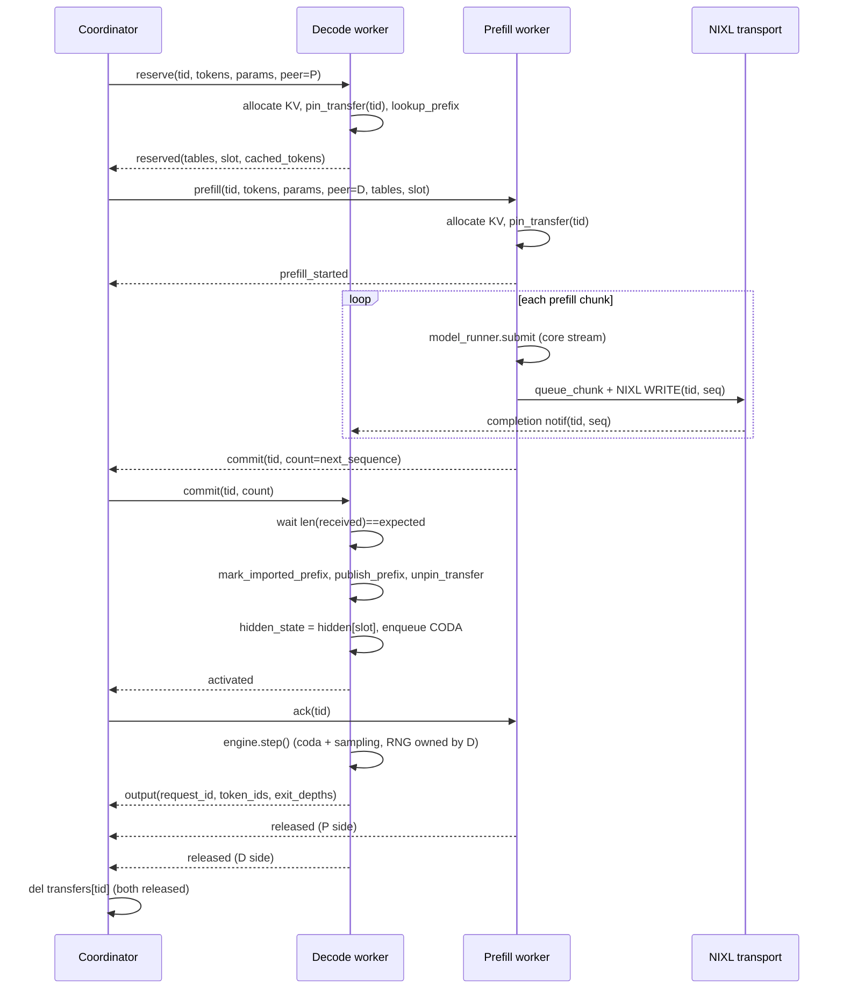

# M9 — PD and KV transfer walkthrough

Module review for the prefill/decode (PD) disaggregation runtime and its NIXL
KV transfer path, prepared against RFC #32 (module M9). It pins a reproducible
baseline, maps the current code onto the three RFC subcomponents, documents the
handoff state machine and failure/cancellation cleanup, records evidence-backed
findings, and proposes a migration target that replaces private-state access
with explicit contracts.

This is a structural review. It does not claim that tests or performance
regressions have passed, and it does not change runtime behavior.

## 1. Baseline and boundary

### Pinned baseline

- Repository: `ThinkFlowLab/vllm-rlt`
- Base commit: `3314c1b` (Merge PR #44, `feat: add synchronous fixed-loop
  self-speculative decoding`)
- Files in scope:

| File | Lines | Role |
| --- | --- | --- |
| `vllm_rlt/pd/engine.py` | 467 | Coordinator: `PDEngine`, `Peer`, `Pending` |
| `vllm_rlt/pd/worker.py` | 391 | Engine owner thread + embedded scheduler-side connector logic: `PDWorker`, `Work`, `worker_main` |
| `vllm_rlt/pd/transport.py` | 176 | Worker-side transport: `NixlConnector`, `Transfer`, `kv_segments`, `partition_segments` |
| `vllm_rlt/pd/config.py` | 45 | `PDConfig` |

### Callers and callees

- Frontend (M1): `vllm_rlt/entrypoints/pd_serve.py` constructs `PDEngine` and
  feeds it to `vllm_rlt/serving/server.py`. The frontend calls only
  `add_request`, `step`, `abort_request`, `has_unfinished_requests`, and
  `close`, but also reads `engine.scheduler.requests` and
  `engine.cache_manager.num_used_blocks` directly (see finding F2).
- Local engine (M2/M5): each `PDWorker` owns a full `LLMEngine`
  (`worker.py:79`), its `Scheduler`, `KVCacheManager`, and `ModelRunner`. PD
  reaches into their private members (findings F1, F3).
- Logical KV (M4): `PDWorker` and `NixlConnector` read
  `cache._get_allocation`, `cache._allocations`, `cache.key_cache`,
  `cache.value_cache`, `cache.storage_depths` directly. Transfer leases use the
  public `pin_transfer` / `unpin_transfer` / `mark_imported_prefix` interface.
- Scheduler (M3): `PDWorker` mutates `scheduler.queues`, calls
  `scheduler._take()`, and mutates `Request` stage/progress fields directly.

### Subcomponent mapping (target)

The RFC defines three subcomponents. The current mapping is uneven:

| RFC subcomponent | Current home | Status |
| --- | --- | --- |
| Coordinator | `PDEngine` (`pd/engine.py`) | Exists, but fakes scheduler/cache for the frontend (F2) |
| Scheduler-side connector | Inline in `PDWorker` (`pd/worker.py`) | Not a separate class; reaches into scheduler private state (F1, F3) |
| Worker-side connector / transport | `NixlConnector` (`pd/transport.py`) | Exists and is the cleanest of the three; still couples to `cache.key_cache`/`value_cache` geometry (F4) |

## 2. Classes and state

### `PDEngine` (coordinator, `pd/engine.py:57`)

Fields and authoritative writers:

| Field | Type | Writer | Purpose |
| --- | --- | --- | --- |
| `peers` | `dict[str, Peer]` | `__init__` | One entry per spawned worker process |
| `requests` | `dict[str, Request]` | `add_request`, `_message` (output/abort) | Active request objects keyed by request ID |
| `transfers` | `dict[str, Pending]` | `add_request`, `_admit`, `_message`, `abort_request` | One entry per transfer generation, keyed by `tid` |
| `scheduler` | `SimpleNamespace` | `__init__` | Synthetic, exposes `.requests` for the frontend (F2) |
| `cache_manager` | `SimpleNamespace` | `__init__`, `_message` | Synthetic, exposes `.num_used_blocks` for the frontend (F2) |
| `outputs` | `deque` | `_message`, `step` | Decoded outputs waiting for the frontend to drain |
| `metrics` | `deque(maxlen=1024)` | `_message` | Per-completed-transfer timing record |
| `closed`, `failure` | bool / str | `close`, `step`, `_terminate` | Liveness/failure state |

Authoritative transfer state lives in `Pending` (`pd/engine.py:38`). Its `phase`
field is a string enum without a typed representation:

```
waiting -> reserving -> prefill -> decode -> (released)
```

`cancelled` is an independent boolean that can be set in any phase via
`abort_request`. The transfer is deleted only when both `p_released` and
`d_released` are true (`_message`, `pd/engine.py:355-367`).

### `PDWorker` (engine owner + embedded connector, `pd/worker.py:44`)

Owns the local `LLMEngine`, the per-role `hidden` pool, the `NixlConnector`,
and the `Work` bookkeeping. `Work` (`pd/worker.py:21`) carries per-transfer
state that mixes connector concerns with scheduler/Request concerns:

| Field | Concern | RFC subcomponent |
| --- | --- | --- |
| `slot`, `peer`, `target_tables`, `target_slot` | Memory/slot bookkeeping | Worker-side connector |
| `chunks`, `next_sequence`, `received`, `expected`, `committed`, `active`, `acknowledged` | Transfer progress | Scheduler-side + worker-side connector |
| `cached_tokens`, `target_cached_tokens` | Prefix accounting | Scheduler-side connector |
| `compute_done`, `compute_released`, `last_event` | Compute lifecycle | Scheduler-side connector |
| `cancelled`, `started` | Control | Coordinator/connector |

The `hidden` pool (`worker.py:70-73`) and `free_slots` are shared between the
connector (which copies `request.hidden_state` into `self.hidden[w.slot]` at
final prefill, `worker.py:263`) and decode activation (which assigns
`request.hidden_state = self.hidden[w.slot]`, `worker.py:340`). This device
state is the M5 `ModelRunner` persistent-state concern, but it is currently
owned by `PDWorker`.

### `NixlConnector` (worker-side transport, `pd/transport.py:71`)

Owns the NIXL agent, registered memory (`storage = (key_cache, value_cache,
hidden)`), and the in-flight transfer queue. `Transfer` (`pd/transport.py:10`)
is a thin handle wrapper. This class is the most self-contained of the three;
its public methods (`connect`, `submit`, `poll`, `busy`, `close`) are close to
the RFC worker-side connector contract.

### Resource-credit accounting (coordinator)

`Peer.blocks`, `Peer.slots`, `Peer.compute_slots` (`pd/engine.py:33-35`) are
coordinator-side credits, incremented in `_admit` (`pd/engine.py:371-374`) and
decremented in `_message` on `prefill_complete`/`released` events
(`pd/engine.py:320-321,356-365`). The coordinator holds exact credits; a worker
`rejected` message is treated as a state mismatch and raises
(`pd/engine.py:353`).

## 3. Functions and arguments

### Coordinator

- `add_request(request_id, prompt_token_ids, sampling_params=None, *, trace_id=None)`
  (`pd/engine.py:281`): validates bounds, checks both role pools have a peer
  with enough `num_blocks`, creates `Pending`, stores it in `transfers` and the
  request in `requests`. Does not reserve; admission happens later in `_admit`.
- `_admit()` (`pd/engine.py:328`): bounded FIFO scan of waiting `Pending`
  entries (priority reorders). For each, picks the least-loaded eligible P and
  D peer by KV fraction then slot fraction, reserves credits eagerly, and sends
  `reserve` to D. Age protection breaks the scan after half the request timeout
  for a blocked waiting request.
- `_message(peer, m)` (`pd/engine.py:181`): the coordinator-side dispatch over
  worker messages. Drives the `Pending.phase` transitions (see sequence diagram
  below) and the release accounting.
- `abort_request(request_id)` (`pd/engine.py:385`): marks `cancelled`, drops
  pending outputs, and sends `cancel` to D plus either `cancel_safe` (if P
  already released) or `cancel` to P. See the cancel sequence diagram.
- `step()` (`pd/engine.py:405`): polls workers, enforces the request timeout,
  admits, and drains `outputs`.
- `_terminate()` (`pd/engine.py:426`): fail-closed shutdown — terminates all
  senders (prefill) before receivers (decode), joins with kill fallback, and
  zeroes credits. The order is deliberate: a failed receiver must never reuse a
  page a still-writing sender could touch.

### Worker

- `accept(command)` (`pd/worker.py:117`): handles `reserve` (D) and `prefill`
  (P). Allocates KV, pins a transfer lease, looks up a local prefix, and either
  replies `reserved` with block tables (D) or starts prefill and replies
  `prefill_started` (P). This is where the scheduler-side connector logic
  begins and where most private-state access concentrates (F1).
- `command(command)` (`pd/worker.py:164`): dispatches control messages:
  `connect`, `reserve`/`prefill`, `cancel`, `cancel_safe`, `commit`, `ack`,
  `stop`.
- `queue_chunk(w, start, end, event, final)` (`pd/worker.py:210`): builds
  per-chunk NIXL WRITE descriptors between source (`cache._get_allocation`
  block tables) and target (`peer` tables). Appends the final prompt hidden
  state as an extra segment when `final` is set.
- `prefill_step()` (`pd/worker.py:232`): rewrites `scheduler.queues[Stage.PREFILL]`
  with only eligible tids, calls `scheduler._take()`, submits through
  `model_runner.submit`, records CUDA events, and queues chunks for each item.
  Restores the original queue with unused tids. This is the most invasive
  private-state manipulation (F1).
- `progress()` (`pd/worker.py:279`): per-tick advancement. Polls NIXL
  completions, records received sequences on D, and for each `Work` either
  drives P-side release/commit/ack or D-side activation (`mark_imported_prefix`
  + `publish_prefix` + `unpin_transfer` + enqueue CODA).
- `run()` (`pd/worker.py:345`): the worker main loop. Polls control messages,
  calls `progress`, runs `prefill_step` (P) or `engine.step()` (D when active),
  and emits `output`/`released`.

### Transport

- `kv_segments(info, tables, start, end)` (`pd/transport.py:18`): maps a valid
  token range `[start, end)` to byte segments over a per-depth block table. Full
  blocks yield one segment covering all layers; partial blocks yield one segment
  per layer so unused tail bytes are never advertised as initialized.
- `partition_segments(source, target, byte_limit, descriptor_limit)`
  (`pd/transport.py:49`): bounds both total bytes and descriptor count per NIXL
  WRITE without copying KV. Yields `(local, remote, size)` chunks.
- `submit(transfer_id, sequence, peer, local, remote, size)`
  (`pd/transport.py:116`): checks `transfer_chunk_bytes` and
  `max_inflight_bytes`, initializes a NIXL WRITE handle with a JSON
  `[transfer_id, sequence]` notification, and posts it. Returns `False` on
  inflight-byte pressure (caller retries next tick).
- `poll()` (`pd/transport.py:137`): checks each pending transfer's state. `ERR`
  or timeout raises with "registered memory must be quarantined" — failed
  memory is never reused. Collects completion notifications as
  `(peer, tid, sequence)`.

## 4. Line-by-line coverage

The detailed review covers the executable logic that drives handoff, cleanup,
and transfer geometry. Auxiliary helpers (`_send`, `_wait`, `_poll`,
`_blocks`, `send`) are summarized rather than line-by-line.

### `PDEngine._message` (`pd/engine.py:181-274`)

- `kind == "fatal"`: raises with the worker traceback. Any worker fatality
  propagates as a coordinator failure, which `_terminate` then converts to a
  fail-closed shutdown.
- `kind == "ready"` / `"connected"` / `"stopped"`: peer liveness transitions,
  no transfer state change.
- `w = self.transfers.get(m.get("tid"))`: late messages for retired generations
  are dropped silently (`if w is None: return`). This is the request-ID-reuse
  guard: an old notification cannot affect a new transfer reusing the same
  external request ID, because `tid` is a fresh UUID per generation.
- `if peer.name not in (w.p, w.d): raise`: a response from a worker not
  assigned to this transfer is a protocol violation.
- `kind == "reserved"` (D): transitions to `prefill`, sends `prefill` to P with
  D's tables/slot. If `w.cancelled`, sends `cancel_safe` to D instead and
  returns — D has already reserved, so cleanup must go through the safe path.
- `kind == "prefill_started"`: timing record only.
- `kind == "prefill_complete"`: releases one P compute slot and records timing.
  This is the P compute-lifecycle event, distinct from KV/submission commit.
- `kind == "commit"` (P): records timing and, if not cancelled, forwards
  `commit` with `count` to D. `count` is `next_sequence`, i.e. the number of
  chunks P queued. This is the **submission boundary**, not GPU-completion
  evidence (D activates on NIXL notifications, not on commit).
- `kind == "activated"` (D): transitions to `decode`, sends `ack` to P.
- `kind == "output"` (D): if not cancelled, rewrites the output's request_id to
  the external ID, copies generated tokens/exit depths onto `w.request`, and
  appends to `outputs`. On `finished`, pops the request from `self.requests`.
- `kind == "released"`: role-specific credit release. P-release also releases
  the compute slot if not already done. Both `p_released` and `d_released`
  being true deletes the transfer and appends a metrics record.
- `kind == "rejected"`: raises — the coordinator holds exact credits, so a
  rejection is a bug, not a backpressure signal.

### `PDEngine._admit` (`pd/engine.py:328-383`)

- Bounded scan: `waiting = list(self.transfers.values())[:max_pending_requests]`.
  Priority policy reorders by `(priority, created)`.
- For each waiting, non-cancelled `Pending`, computes eligible P and D peers by
  `slots < max_seqs`, P `compute_slots < active_limit`, and
  `blocks + required <= num_blocks - watermark` (watermark only when the peer
  has no active slots, i.e. headroom for the first request).
- Picks the least-loaded peer by KV fraction then slot fraction. If both roles
  have a candidate, reserves credits eagerly (`p.blocks += ...`, `d.blocks += ...`,
  slot increments) and sends `reserve` to D. Eager reservation means a later
  D-side rejection is a state mismatch (caught above).
- Age protection: if no candidate pair and the waiting request is older than
  half the request timeout, break the scan so a blocked long request is not
  hidden by continuous small arrivals.

### `PDWorker.accept` (`pd/worker.py:117-162`)

- D role: `actual_params = params` (D owns all sampling/RNG). P role:
  `actual_params = replace(params, max_tokens=1)` — P never samples, it only
  needs one placeholder token of decode capacity for the final prompt position.
- `self.engine.add_request(tid, ...)` then immediately
  `self.engine.scheduler.queues[Stage.WAITING].remove(tid)`: the request is
  admitted out-of-band, bypassing the scheduler's own admission. This is F1.
- `prefix = self.cache.lookup_prefix(command["tokens"])`; `initial` is
  `len(tokens)` when incremental allocation is on, else full `capacity`.
- `self.cache.allocate(tid, capacity, initial_tokens=initial, prefix=prefix)`.
  On failure, `scheduler.abort(tid)` and `rejected`.
- `self.cache.pin_transfer(tid, tid)`: the transfer ID is also used as the lease
  ID. The lease defers `free` until `unpin_transfer`.
- D replies `reserved` with `cache._get_allocation(tid).block_tables` (private
  allocation access — F1) and `slot`.
- P sets `target_tables`/`target_slot` from the command, sets
  `request.num_prefilled_tokens = hit`, and if the local prefix extends past
  the target's `cached_tokens`, queues a chunk for the delta immediately
  (prefill can start draining prefix KV before compute). Enqueues PREFILL and
  replies `prefill_started`.

### `PDWorker.prefill_step` (`pd/worker.py:232-277`)

This is the single most invasive private-state manipulation site.

- Eligibility filter: a tid is eligible if it has no queued chunks and its
  `last_event` (if any) has fired. This bounds both posted network work and
  unsubmitted data to one outstanding chunk per request.
- `original = self.engine.scheduler.queues[Stage.PREFILL]` is saved;
  `self.engine.scheduler.queues[Stage.PREFILL] = deque(eligible)` is installed;
  `batch = self.engine.scheduler._take(Stage.PREFILL)` is called; then the
  original queue is rebuilt with eligible tids removed and unused tids (those
  `_take` did not pack) appended back. The scheduler queue is being used as
  scratch space for the connector's own batching.
- `ticket = self.engine.model_runner.submit(batch)`: the connector submits
  directly through the runner, bypassing any executor boundary (F1, M5).
- On the core stream, for each item: advances `num_prefilled_tokens`, copies
  `request.hidden_state` into `self.hidden[w.slot]` on the final chunk,
  records a CUDA event, calls `queue_chunk`, and `publish_prefix` with the
  event. Re-enqueues PREFILL if not final.
- `del ticket`: the prefill ticket carries no readback slot; its events are
  retained by `model_runner.events` and `w.last_event`.

### `PDWorker.progress` (`pd/worker.py:279-343`)

- `self.cache.poll_prefixes()` then `_, notifications = self.connector.poll()`.
- For each notification `(peer, tid, sequence)`: drops it if `w is None or
  w.cancelled` (late generation). Validates role/peer/sequence. Raises on a
  sequence arriving after activation (`w.active and sequence not in
  w.received`) — once D starts decoding, no further KV writes are allowed.
- P path: if cancelled and not busy, `remove(w)`. If `compute_done` and the
  last event fired, release the runner slot and send `prefill_complete`. If
  chunks remain and the head chunk's event fired and `connector.submit`
  succeeds, pop it. If `compute_done` and no chunks and not committed, send
  `commit`. If acknowledged and not busy, `remove(w)`.
- D path: if not cancelled, not active, and `expected` is set, wait until
  `len(w.received) == w.expected` and the active count is under
  `active_limit`. Then `mark_imported_prefix` (validates the prefix was not
  already initialized and the request is not release-requested),
  `publish_prefix`, `unpin_transfer`, set
  `request.num_prefilled_tokens = len(prompt)`, `request.loops_done =
  total_ut_steps`, `request.hidden_state = self.hidden[w.slot]`, enqueue CODA,
  set `active`, and send `activated`.

### `PDWorker.remove` (`pd/worker.py:106-115`)

Releases the runner slot, aborts the scheduler request, frees + unpins the KV
allocation, recycles the slot, deletes `Work`, and sends `released`. This is
the single cleanup path for both P and D, reached from cancel, cancel_safe,
ack-completion, and fatal paths.

### `kv_segments` (`pd/transport.py:18-47`)

- Validates `0 <= start < end` and that `end` does not exceed the table
  capacity.
- For each per-depth `table`, iterates logical blocks in `[start//page,
  (end-1)//page]`. For each block, `lo = max(start - logical*page, 0)`,
  `hi = min(end - logical*page, page)`.
- Full block (`lo == 0 and hi == page`): one segment of `block_bytes` covering
  every layer. Partial block: one segment per layer at
  `base + block*block_bytes + layer*layer_bytes + lo*token_bytes`, length
  `(hi-lo)*token_bytes`. Both K and V bases are emitted, preserving every depth
  (the outer loop is over `tables`, one per storage depth).

### `partition_segments` (`pd/transport.py:49-69`)

`zip_longest(source, target)` pairs source and target segment lists. Geometry
mismatch (`src[1] != dst[1]`) raises. Splits each pair into chunks bounded by
`byte_limit` (total bytes per NIXL WRITE) and `descriptor_limit` (descriptors
per WRITE), yielding `(local, remote, size)` triples without an intermediate KV
copy.

### `NixlConnector.submit` and `poll` (`pd/transport.py:116-164`)

- `submit`: enforces `transfer_chunk_bytes` per WRITE and `max_inflight_bytes`
  total. Builds a JSON notification `[transfer_id, sequence]`, initializes the
  WRITE handle, appends the `Transfer` ticket to `self.pending` (ownership is
  retained even if `agent.transfer` later fails), increments `inflight_bytes`,
  and posts. `agent.transfer == "ERR"` raises.
- `poll`: for each pending ticket, `check_xfer_state` is `ERR` or past
  `request_timeout` → raise "registered memory must be quarantined". `DONE`
  releases the handle, decrements `inflight_bytes`, and appends to `finished`.
  Completion notifications are decoded from `get_new_notifs()` into
  `(peer, tid, sequence)`.
- `close`: refuses to deregister memory while `self.pending` is non-empty, then
  removes remote agents and deregisters. This preserves the quarantine invariant
  on shutdown.

## 5. Evidence-based findings

Findings are ordered by priority. Each gives location, reachable trigger,
observable impact, and a recommendation. They are design concerns against the
RFC, not necessarily runtime defects.

### F1 — `PDWorker` manipulates scheduler private queues and `_take()`

- **Priority:** high
- **Location:** `pd/worker.py:108-109,130-131,161,180,212,233-251,275,341`
- **Trigger:** every prefill and activation tick.
- **Impact:** the RFC M9 section states "Direct PD-worker manipulation of
  queues, Request objects, and `_take()` should migrate to explicit
  scheduling/execution protocols." `prefill_step` rewrites
  `scheduler.queues[Stage.PREFILL]`, calls `scheduler._take()`, and rebuilds
  the queue around it. The scheduler's internal invariants (batch construction,
  fairness counters, watermark headroom from M3) are bypassed by an external
  caller that does not own them.
- **Recommendation:** introduce a scheduler-side connector that requests a
  prefill batch through a public scheduler method (e.g. a `take_prefill_filter`
  predicate or an explicit `submit_handoff` call) and reports completion
  through a `SchedulerOutput`-style contract. The connector must not touch
  `queues` or `_take`.

### F2 — `PDEngine` fakes `scheduler` and `cache_manager` with `SimpleNamespace`

- **Priority:** high
- **Location:** `pd/engine.py:96-97`; `cache_manager.num_used_blocks` maintained
  by hand at `pd/engine.py:367`.
- **Trigger:** frontend reads `engine.scheduler.requests` or
  `engine.cache_manager.num_used_blocks`.
- **Impact:** the RFC M6 contract states "PD should not need synthetic
  scheduler/cache objects to satisfy Serving's assumptions." The current
  frontend (M1) depends on `engine.scheduler.requests` and
  `engine.cache_manager`; `PDEngine` satisfies this by exposing empty
  namespaces. `num_used_blocks` is a coordinator-maintained aggregate that
  hides per-peer pressure and can drift from worker reality between messages.
- **Recommendation:** expose a stable engine interface (resource stats, active
  requests, outputs) as methods on `PDEngine`, and migrate the frontend off
  `engine.scheduler`/`engine.cache_manager` (M1 dependency). Remove the
  `SimpleNamespace` shims once the frontend no longer needs them.

### F3 — `PDWorker` mutates `Request` device and progress fields directly

- **Priority:** high
- **Location:** `pd/worker.py:145,156,260,263,306,338-340`.
- **Trigger:** D-side accept sets `request.stage = RECEIVING`; prefill advances
  `request.num_prefilled_tokens`; activation sets `num_prefilled_tokens`,
  `loops_done`, and `request.hidden_state = self.hidden[w.slot]`; P-side release
  clears `request.hidden_state = None`.
- **Impact:** RFC principle 2 separates scheduler-side state (logical
  progression) from worker-side state (device tensors). Mutating a shared
  `Request` object from the connector couples the two and makes late/cancelled
  results hard to attribute by identity. The `Request.hidden_state` assignment
  in particular hands a device tensor into scheduler-owned state.
- **Recommendation:** route handoff progression through scheduler-side updates
  and device-state handoff through the M5 worker. The connector should report
  completion/activation events, not reassign `Request` fields.

### F4 — Worker-side transport reads KV tensor geometry from `KVCacheManager`

- **Priority:** medium
- **Location:** `pd/transport.py:77-85` (`NixlConnector.__init__` reads
  `cache.key_cache`/`value_cache` strides and data pointers);
  `pd/worker.py:149,212` (`cache._get_allocation(...).block_tables`).
- **Trigger:** connector construction and every `queue_chunk`.
- **Impact:** RFC principle 3 puts device KV storage under M5 and logical block
  tables under M4. The transport currently depends on both the physical tensor
  layout (M5 concern) and the private `_Allocation` structure (M4 concern) to
  build segment descriptors. This blocks the M4/M5 split.
- **Recommendation:** define a small KV geometry descriptor (data pointers,
  strides, block size, depths, device) owned by M5 and a public block-table
  accessor owned by M4. `NixlConnector` consumes both through stable views
  rather than private fields.

### F5 — Handoff contract is implicit and undocumented

- **Priority:** medium
- **Location:** protocol spread across `_message`, `accept`, `progress`,
  `command`.
- **Trigger:** any change to the handoff flow.
- **Impact:** the RFC requires an explicit handoff contract: valid KV ranges
  per depth, destination block mappings, final prompt hidden state with
  coda/sampling by D, transfer generation/sequence/commit/receive-completion/
  ack, safe release ordering under cancel/timeout/worker failure, and
  prefix/in-flight/preemption constraints. The current implementation honors
  these (see the sequence diagrams below), but they are not written down, so
  reviewers and future contributors must re-derive them from code.
- **Recommendation:** keep the sequence diagrams and contract list in this
  document as the reference; promote them into a `docs/pd_handoff_contract.md`
  once the M9 boundary is agreed.

### F6 — `Pending.phase` is an untyped string

- **Priority:** low
- **Location:** `pd/engine.py:44` (`phase: str = "waiting"`).
- **Trigger:** state transitions in `_message`.
- **Impact:** the M3 review called out the same pattern (strings hiding finite
  state) and introduced enums. `phase` has four reachable values and a terminal
  release state, all compared by string literal.
- **Recommendation:** introduce a `PendingPhase` enum when touching the
  coordinator for other reasons; not a standalone change.

### F7 — PD has no interaction with preemption

- **Priority:** low (open question, not a defect)
- **Location:** `pd/engine.py` does not pass `enable_preemption`; `PDConfig`
  has no preemption field.
- **Trigger:** D-pool pressure with long decode requests.
- **Impact:** RFC principle 3 requires preemption to preserve KV, hidden state,
  loop progress, exit state, and RNG semantics, and the handoff contract must
  state "constraints between prefix hits, in-flight transfers, and preemption."
  It is unclear whether preemption should ever fire on a D worker with an
  active transfer lease, or how a preempted D request's in-flight transfer is
  drained.
- **Recommendation:** document PD + preemption as an explicit open question in
  the contract. If preemption is ever enabled for D, the transfer lease must be
  drained or cancelled before victim selection.

## 6. Target design and migration

### Boundary constraint

M9 replaces private-state access by **consuming** the public contracts owned
by M3 (scheduler), M4 (logical KV), M5 (device execution and KV storage), and
M1 (frontend engine interface). It does **not** introduce M9-owned scheduling
or KV interfaces: no new scheduler admission path, no new KV allocation or
lease API, no new device-state ownership. Where a needed interface does not
yet exist, M9 records the dependency and waits for the owning module rather
than defining a parallel one. The `PDEngine` frontend cleanup in particular
follows the stable M1 interface once available; until then the
`SimpleNamespace` shims remain as a compatibility adapter (F2) rather than
being replaced by an M9-defined facade.

### Target structure

```
PDEngine (coordinator)
  |  consumes M1 stable engine interface (add_request/step/abort/close,
  |  active requests, resource stats); no synthetic scheduler/cache
  |
  +-- SchedulerSideConnector (new, extracted from PDWorker)
  |     receive-wait state, handoff plan after allocation,
  |     completion feedback, activation conditions, deferred release
  |     consumes M3 scheduler public protocol (no queues/_take)
  |     consumes M4 KV lease public API (pin/unpin/mark_imported)
  |
  +-- WorkerSideConnector (NixlConnector + thin wrapper)
        memory registration, KV/hidden movement, CUDA events,
        NIXL handles, completion notifications, deregistration
        consumes M5 KV geometry descriptor + M4 block-table accessor
        hidden pool / slot lifecycle delegated to M5 ModelRunner/Worker
```

### Migration sequence

Each step stays runnable and verifiable; behavioral fixes are separated from
structural changes, following the M3 template. Steps that depend on another
module's public contract are gated on that contract being available; they are
not implemented ahead of it with an M9-owned substitute.

1. **Extract `SchedulerSideConnector`** (structural, no dependency): move
   `accept`, `progress`, `prefill_step` connector logic into a new class that
   holds `Work` state. Keep `PDWorker` as the engine owner thread that drives
   the connector. Private-state access is preserved behind the new class
   boundary; no behavior change. CPU regression suite must stay green.
2. **Replace scheduler private access** (depends on M3): swap
   `scheduler.queues`/`_take` access for the M3 scheduler public protocol
   once it exists. M9 does not define its own scheduling interface; if the M3
   contract is not yet available, this step waits and the connector keeps the
   existing calls behind its boundary. Coordinate with the M3 owner
   (@bjf-frz / @YzXiao101).
3. **Route device state through M5** (depends on M5): move the `hidden` pool
   and `model_runner.submit` orchestration into the M5 worker. The connector
   reports completion events; it does not assign `Request.hidden_state`. M9
   does not define a new device-state interface. Coordinate with the M5 owner.
4. **Replace KV geometry access** (depends on M4/M5): consume the M5 KV
   geometry descriptor and M4 public block-table accessor in `NixlConnector`
   and `queue_chunk`. M9 does not define its own KV layout or allocation API.
5. **Remove `SimpleNamespace` shims** (depends on M1): follow the stable M1
   frontend engine interface once available; expose `resource_stats()` /
   `active_requests()` only if M1 owns them, otherwise consume them from M1.
   Do not build an M9-owned facade.

Compatibility adapters are introduced first, callers are migrated, and only
then are the old private-state paths removed. Two long-lived sources of state
must not coexist.

## 7. Validation

### Existing coverage

`tests/test_pd.py` covers:

- Transfer lease defers `free` until the last reader
  (`test_transfer_lease_defers_free_until_last_reader`).
- Receive publishes all depths only after commit
  (`test_receive_publishes_all_depths_only_after_commit`).
- Segment ranges cover only valid tokens and all layers/depths
  (`test_segment_ranges_cover_only_valid_tokens_and_all_layers_depths`).
- Request-ID reuse after cancel
  (`test_pd_reuses_request_id_after_cancel`).
- Cancel during execution and close with a live request
  (`test_pd_cancel_during_execution_and_close_with_live_request`).
- Coordinator no-progress and receiving-state handling
  (the `Mock`-based engine tests).

### Unverified areas

- Real multi-process NIXL execution over UCX requires CUDA and a NIXL build;
  CPU runs skip these cases. GPU/NIXL validation requires the user's applicable
  experiment scope and a reserved device.
- The hidden-state handoff at final prefill, depth-specific KV validity at each
  destination depth, and first-token semantics are only exercised end-to-end on
  GPU. A behavior-preserving refactor must compare outputs and exit depths
  against the current implementation on the same model and seed.
- Cancel during an in-flight transfer, worker failure during transfer, and
  resource reclamation after failure are covered by unit tests for the lease
  path but not by a multi-process failure-injection test.
- PD + preemption interaction is not tested and is an open question (F7).

When implementation PRs land, the relevant checks are: changed-file Ruff and
format, the CPU regression suite (baseline: 245 passed, 114 skipped as of PR
#50), and a GPU PD comparison on a controlled configuration for throughput,
TTFT, ITL/TPOT, and transfer bytes under unchanged settings.

## Appendix: handoff sequence diagrams

### Normal handoff



### Cancel and safe-release ordering

```mermaid
sequenceDiagram
    participant C as Coordinator
    participant D as Decode worker
    participant P as Prefill worker
    participant N as NIXL transport

    Note over C: abort_request sets Pending.cancelled
    C->>D: cancel(tid)
    alt P already released (p_released)
        C->>D: cancel_safe(tid)
        D->>D: remove(w): release runner, free+unpin KV, recycle slot
        D-->>C: released (D)
    else P still alive
        C->>P: cancel(tid)
        P->>P: chunks.clear(), drop from PREFILL queue
        P->>P: wait until not connector.busy(tid)
        P->>D: (no direct writes; quarantine ensures safety)
        P->>P: remove(w): release runner, free+unpin KV, recycle slot
        P-->>C: released (P)
        C->>D: cancel_safe(tid)
        D->>D: remove(w)
        D-->>C: released (D)
    end
    C->>C: del transfers[tid] (both released)
```

The ordering invariant is: a receiver is never removed while a sender could
still be writing to its registered memory. On NIXL `ERR` or transfer timeout,
`NixlConnector.poll` raises with "registered memory must be quarantined,"
`worker_main` keeps the failed process alive until the coordinator terminates
senders before receivers in `_terminate`, and `close` refuses to deregister
memory with in-flight transfers.
