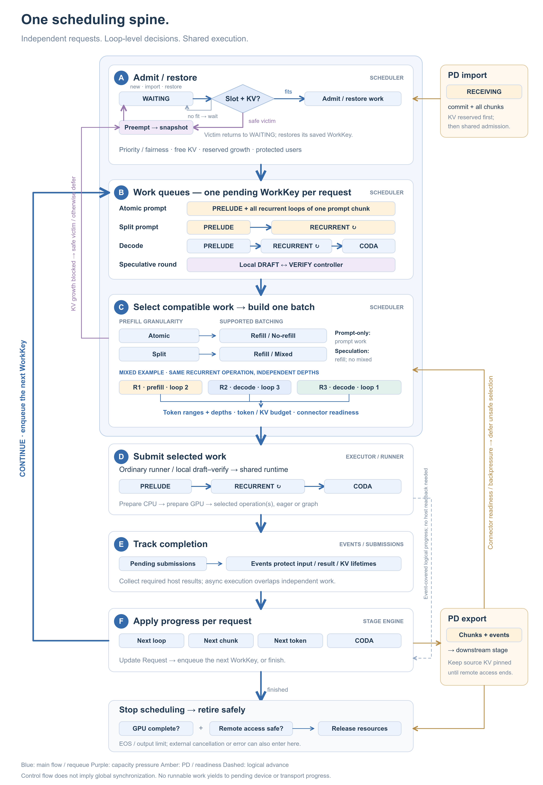
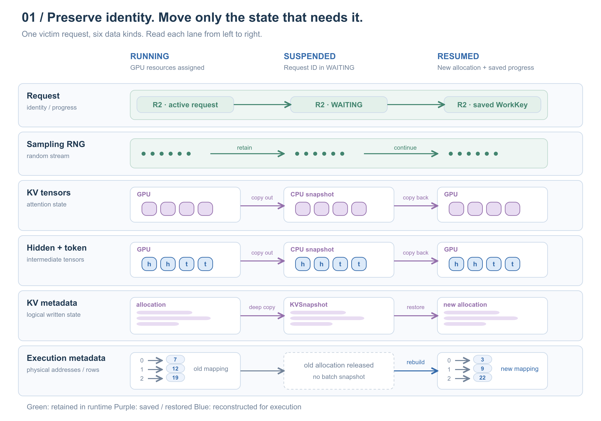
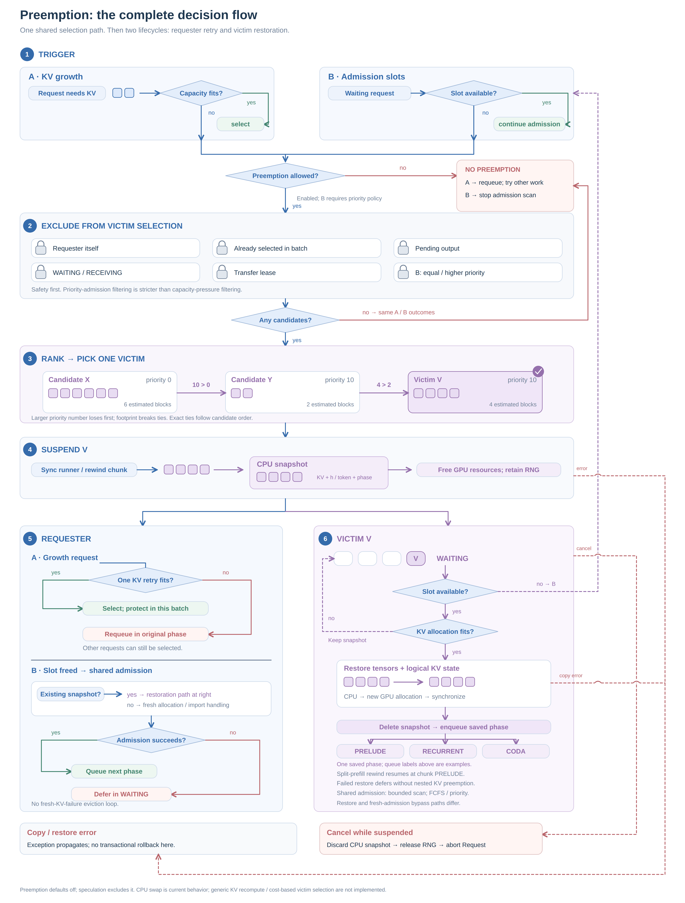
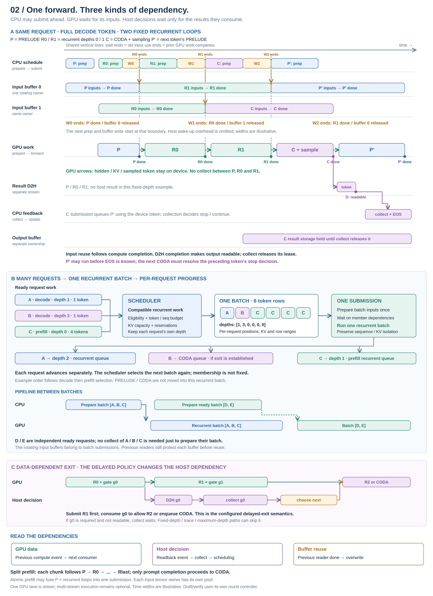
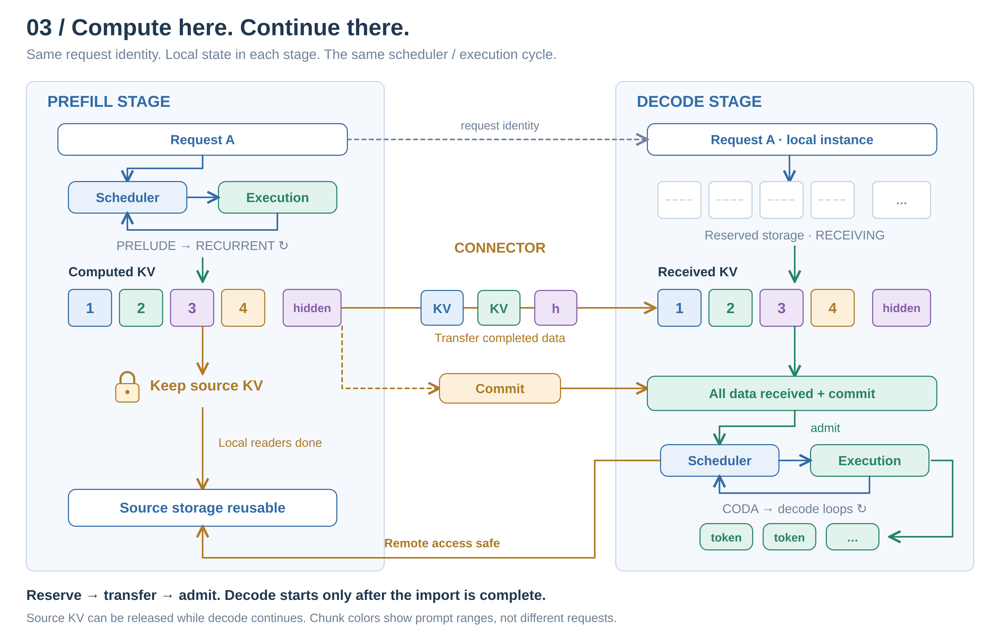
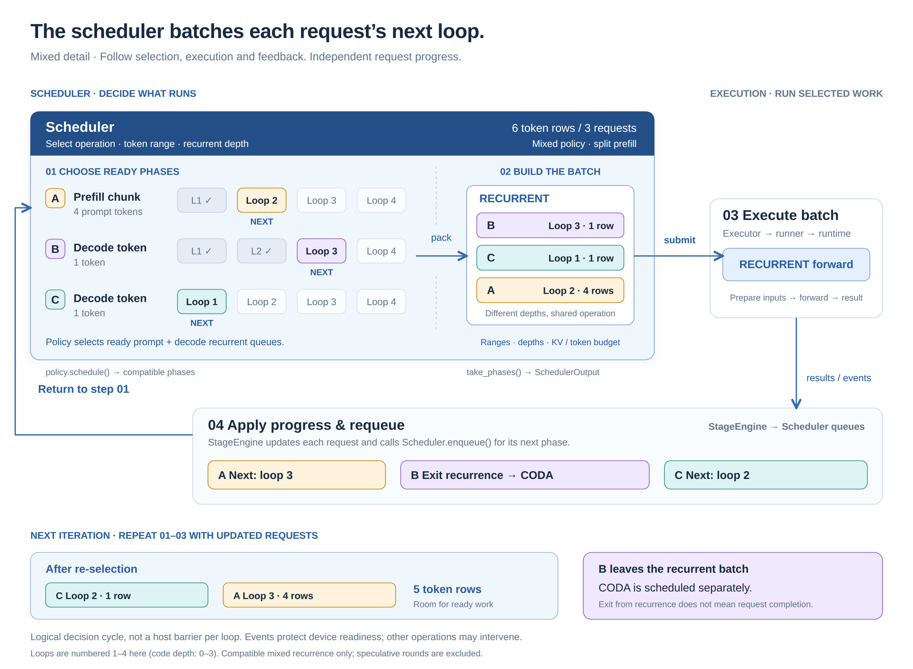

# Scheduler: admission and loop-level scheduling

The overview follows the full request lifecycle. Mixed recurrence is one branch;
its request-by-request example is expanded separately below.

## Scheduler overview



[Open full-size overview](diagrams/scheduler-overview.png) ·
[Open SVG](diagrams/scheduler-overview.svg)

Read the thick blue **A → B → C → D → E → F** path from top to bottom.
Ongoing requests return from **F to B**. Thin lines connect PD import/export,
capacity pressure, restoration and retirement directly to that flow. They are
branches of the same runtime, not independent subsystems a request must visit.

### A — Admit: can this request enter execution?

The WAITING box holds requests awaiting admission. New requests, completed PD imports and
preempted requests awaiting restoration share admission. `Slot + KV?` checks the
active-request limit and the KV budget, including growth reserved for existing
requests. Priority/FCFS and bounded bypass decide which waiting requests get a
chance; they do not replace the resource checks.

If resources fit, the request becomes ACTIVE and enters the appropriate work
queue in B. A new prompt starts prompt work; a fully imported prompt enters
CODA after admission; restoration returns to the saved `WorkKey`. No fit means
waiting. Where preemption is enabled, a safe victim can be suspended and later
restored through this same admission path. These decisions are inside A, not a separate post-processing step. The request sent back to WAITING by preemption is the **victim**, not necessarily the candidate whose admission was blocked. Restoration is retried through resource checks and returns the victim to its saved work.

The amber **PD import → A** line starts only after the connector has observed
commit and all expected chunks. Its destination Request and prompt KV mapping
already exist; receiving data alone does not grant an execution slot.

### B — Ready queues: what does each request need next?

B is a collection of work queues, not a model computation. Each Request retains
its own position, prompt frontier and recurrent depth. The diagram groups queues
by the work they represent:

- **Atomic prompt (`PROMPT_ATOMIC`):** PRELUDE and all recurrent depths of a
  prompt chunk run in one submission. Chunking and yielding between recurrent
  depths are separate choices.
- **Split prompt (`PROMPT_PRELUDE`, `PROMPT_RECURRENT`):** PRELUDE prepares a
  chunk, then RECURRENT work can be selected at individual depths. Prompt tokens
  still traverse the full model depth.
- **Decode (`DECODE_PRELUDE`, `DECODE_RECURRENT`, `DECODE_CODA`):** PRELUDE
  prepares the current token, RECURRENT advances its hidden state, and CODA
  produces logits after recurrence exits.
- **Speculative round (`SPECULATIVE`):** the local controller drafts candidate
  tokens and verifies them. A round expands into model calls rather than becoming
  another model operation alongside PRELUDE, RECURRENT and CODA.

Queue membership is not proof that GPU or transport work has completed. C checks
scheduling eligibility; execution events order the actual device consumers.

### C — Select and batch: which work runs now?

Selection combines different decisions; the implementation class names are not
peer conceptual choices:

- **Prefill granularity — atomic or split:** does a prompt chunk finish all its
  recurrent depths in one submission, or yield at loop boundaries?
- **Batching — refill or no-refill:** can prompt work replenish ongoing
  generation, or must the current cohort drain first? **Mixed** additionally
  combines compatible prompt and decode recurrent spans in the same batch;
  refilling alone does not imply a mixed batch.

The ordinary-generation rows in C show currently supported combinations:
atomic with refill/no-refill, and split with refill/mixed. These are compatibility
rules, not a claim that the two dimensions mean the same thing.
`SplitPrefillPolicy` uses refill ordering with split prompt work;
`MixedPolicy` extends that behavior with recurrent co-batching.

Prompt-only is a stage-role constraint. Speculation selects a local draft/verify
controller; it currently requires refill, supports atomic/split prefill subject
to model constraints, and excludes mixed. See
[policies and execution granularity](#policies-and-execution-granularity).

The colored tiles illustrate a mixed recurrent batch: R1 is a prompt span at
loop 2, while R2 and R3 decode at loops 3 and 1 (displayed depths are 1-based).
They represent selected request spans. Each span records a Request,
token range and recurrent depth. Selection shares token/sequence limits and KV
capacity protection. Compatible ordinary spans share one model operation;
request depths need not match. Mixed combines prompt and decode recurrent work;
it does not combine speculative verification rows.

The purple **C → A: preemption** branch handles failed KV growth when safe
preemption is possible; blocked requests otherwise requeue. Selected requests
must not be evicted while constructing their own batch. The amber **connector → C**
line is nonblocking readiness/backpressure: defer a request that cannot safely
produce more transferable state, while allowing other runnable work to proceed.

C returns a `SchedulerOutput`; it does not build device tensors or advance
completed progress. If nothing is runnable, the engine services pending work or
yields for transport progress. It need not attempt admission on every tick.

### D — Execute: prepare inputs and run the selected model work

`Executor.submit()` dispatches ordinary work to the model runner, or a speculative
round to its local controller. Both use the shared model runtime. CPU preparation
plans rows/routing; GPU preparation stages inputs and metadata before computation.

The full operation names replace the earlier P/R/C abbreviations:

| Operation | Meaning |
| --- | --- |
| **PRELUDE** | Prepare token hidden states, including model-specific input layers. |
| **RECURRENT** | Run the shared transformer core at the selected recurrence depth; its output can feed another loop. |
| **CODA** | Run the model's output stage and, when requested, produce vocabulary logits. Sampling/output handling follows in the surrounding runtime. |

The arrows inside D show model operation order and recurrent repetition. They do
not require every submit to execute all three operations. A recurrent batch can
execute only RECURRENT; atomic prefill can combine PRELUDE with consecutive loops.
Huginn's prelude/coda also have their own attention/KV work, so these names are
more general than “embedding” and “LM head.”

### E — Track completion: what is still using device state or buffers?

Pending submissions retain result/readback storage and completion evidence.
They are execution tickets, not additional Request work items. The diagram does not prescribe a universal queue count shared by every controller.

Events prevent buffer reuse while earlier GPU consumers still read them. A
synchronous path collects host-dependent results when needed. An asynchronous
path can prepare or submit more work before collecting earlier results, within
its bounded-buffer and dependency rules. Collection may wait when a necessary
result or safe reuse is not ready; the diagram does not imply all waits vanish.

The pale dashed **D → F** line is important: host-side logical progress can advance
under a recorded event without first copying a result back. It does not bypass
GPU dependencies or authorize early resource reuse.

### F — Apply progress: what should each request do next?

`Scheduler` applies progress and result-dependent decisions per `Request` using
the selected `WorkKey` (`update_from_output()` or `update_after_submission()`),
then enqueues its next work. `StageEngine` applies side effects such as connector
notifications, runner finalization, and retirement. The four labels show common
continuations: another loop, another prompt chunk, the next generated token, or
CODA after recurrence exits. The blue return arrow leads back to B, not A:
continuing requests keep their admitted resources.

For example, after one recurrent batch, a prompt span can advance to its next
depth while a decode token exits into CODA. A later CODA result can end the
request or make its next token ready for PRELUDE. Different members of a batch
do not have to take the same route.

Two connected branches leave this progress path:

- **F → PD export:** for an explicitly routed prompt, the connector borrows
  chunk ranges and completion events. Transfer can overlap remaining prompt
  computation. Source KV pins survive until local readers and remote access
  finish; transport commit alone is insufficient for release. The connector
  also reports readiness back to C.
- **F → retirement (downward):** EOS or the output limit stops further scheduling. External
  cancellation/error can enter retirement directly without waiting for a normal
  F result. GPU completion and remote-access safety gate buffer/KV release.
  Fatal transport errors may require peer shutdown before reclamation.

The thin **export → retirement** connection carries the same lifetime rule:
finishing local compute does not imply the downstream worker has stopped reading
source storage. “Stop scheduling” and “release resources” are separate actions.

### How to read the whole loop

A admits resources; **B → C → D → E/F → B** repeatedly advances the request.
The thick line is the primary control flow, not a mandatory global barrier between
stages. Policy choices and model/backend constraints determine which branches
are available. The next figure expands one such branch: mixed recurrence.

## Three close-up views

Each view expands a decision in the overview with a concrete lifecycle.

### 1. Request state, KV pressure and restoration

Overview region: **A ↔ C**. Preemption keeps the Request alive while reclaiming
selected device resources. Data ownership and scheduling policy are separate:
the scheduler chooses a victim; `PreemptionManager` currently uses CPU snapshots.



[Open full-size PNG](diagrams/scheduler-preemption-detail.png) · [Open SVG](diagrams/scheduler-preemption-detail.svg)

Read the upper diagram by data kind, from running to suspended to resumed.
Green lanes retain runtime state; tensor lanes show CPU copies; the bottom
metadata lane shows new physical mappings rather than reuse of old addresses.
Hidden/token copies apply when those tensors exist. Physical block IDs are
illustrative. 

#### Complete preemption policy



[Open full-size policy diagram](diagrams/scheduler-victim-selection.png) · [Open SVG](diagrams/scheduler-victim-selection.svg)

Follow 1–4 down the shared path, then read the two continuations separately:
**5 is the requester**, and **6 is the victim V**. A and B identify trigger paths,
not request IDs. The candidate cards X, Y and V in step 3 illustrate ranking only: X and Y
are alternatives; V is the selected victim. They are unrelated to trigger labels
A and B. Green exits proceed without further preemption; red exits defer, stop
admission or report an error. Purple lines track the suspended request. Crossing
arcs on the right indicate separate paths, not joins.

| Diagram step | What is shown |
| --- | --- |
| 1. Trigger | A: failed token-capacity growth. B: no active slot during admission. Available capacity/slots bypass preemption; disabled preemption or non-priority B stops the attempt. |
| 2. Protection | Exclude the requester, already-selected requests, pending outputs, WAITING/RECEIVING requests and transfer leases; B also excludes equal/higher-priority victims. An empty candidate set leads to the A/B defer/stop outcomes. |
| 3. Ranking | Lower service priority first, then larger estimated footprint; pick one victim. |
| 4. Suspend | Synchronize, rewind unfinished split prefill if applicable, snapshot, release device resources and retain RNG. |
| 5. Requester | A retries once, then selects or requeues. B continues shared admission, including restore or fresh allocation/import handling, and defers if admission fails. |
| 6. Victim | Shared WAITING, slot check, allocation, tensor restoration, synchronization, snapshot deletion and saved-work enqueue. Slot shortage returns to B; failed KV allocation retains the snapshot and waits. |
| Red exits | Cancellation discards suspended state and aborts; snapshot/restore exceptions propagate without transactional rollback in this manager. |

The detailed rules below describe configuration restrictions, scan/bypass
behavior, ordering ties and current recovery limitations. The diagram covers
preemption policy; it does not expand the separate connector import protocol.

#### What happens to each kind of data?

| Data | While suspended | On resumption | Current owner / implementation |
| --- | --- | --- | --- |
| Request identity and logical progress: token history, position, counters | The original Request stays in the registry; its `status` becomes WAITING; the resume work is saved separately. | Reuse the same Request, activate it and enqueue the saved `WorkKey`. | `Scheduler.requests`, `Scheduler.waiting`, `Scheduler.work_queues`, `PreemptionManager.snapshots` |
| Sampling RNG | Retained by the runner's RNG manager; not serialized into the CPU snapshot. | Continue the same random stream. | `ModelRunner.suspend()` preserves RNG but frees the runner execution slot. |
| KV tensors | Copy allocated KV pages to CPU, then release the request's GPU allocation. Shared/cached pages need not all become free. | Allocate fresh GPU blocks and copy the saved pages into them. | `KVCacheManager.snapshot()` / `restore()` |
| KV logical metadata: capacity, page count, written state per plane | Save capacity and page count; deep-copy written-state metadata into `KVSnapshot`. | Restore written-state metadata onto the new allocation. | `KVSnapshot` and cache allocation |
| Physical KV mapping and batch execution metadata: block tables, write locations, row indices | Do not preserve the old batch as a resumable execution object. The old allocation is released. | Allocation establishes physical block mappings; subsequent batch preparation derives execution metadata from current mappings and progress. | Cache allocation and `ModelRunner.prepare_on_cpu()` / `prepare_on_gpu()` |
| Intermediate hidden state and input-token tensor | When present, copy to CPU and clear their references on the Request. | Copy back to the cache device and attach to the same Request. | `PreemptionManager` |

There is no dedicated queue containing snapshots. `Scheduler.waiting` contains request IDs; `snapshots[request_id]` contains `work`, `kv`, `hidden` and `token`. Persistent
logical state must not be confused with physical-address metadata that becomes
invalid when GPU resources are reassigned.

For split prefill, `_rewind_split_prefill()` first resets an unfinished chunk to `num_prefilled_tokens` and returns `WorkKey.PROMPT_PRELUDE`. The snapshot therefore records the rewound work, not necessarily the loop at which the request was interrupted. The unfinished chunk is replayed after restoration.

#### Current policy: triggers and eligibility

`SchedulerConfig.enable_preemption` defaults to `False`. When enabled,
StageEngine binds the suspend/resume callbacks. Speculative decoding currently
rejects preemption; it requires refill scheduling with preemption disabled.

| Situation | Action in the current implementation |
| --- | --- |
| A selected candidate needs a larger token frontier and `ensure_capacity()` fails | Attempt one safe victim, then retry allocation once for this candidate. |
| Active-request slots are full under priority admission | Attempt one strictly lower-priority victim to free a slot. This uses the same snapshot path even if the immediate shortage is a slot rather than KV. |
| Active slots are full under FCFS, or no victim can free a priority slot | Stop that admission scan. |
| A fresh request passes the slot check but fails its allocation budget | Defer it under admission scan/bypass rules. This branch does not independently loop over victims to make its allocation fit. |
| Restoring a suspended request cannot allocate KV | Keep its snapshot and defer it; restoration does not itself recursively preempt other requests. The preceding priority slot check can still preempt. |

Before ranking victims, exclude the requesting Request itself, WAITING and
RECEIVING requests, requests with pending output placeholders, requests already
selected for the current batch, and allocations with transfer leases. Priority
admission additionally excludes equal/higher-priority requests. The selected
batch exclusion set is empty during admission, which runs before batch selection.

#### Current policy: ranking and retry

Eligible victims are ranked by this pair, with the largest pair selected:

```python
(priority, required_blocks(position + 1))
```

A larger numeric priority means lower service priority: priority 10 loses to 0.
Within the same priority, a larger estimated current-position KV footprint wins.
That footprint is not the exact number of reclaimable physical pages and does
not account for transfer cost. Exact ties follow candidate iteration order.
Memory-pressure selection uses this ranking even under FCFS; only priority
admission requires the victim to be strictly lower priority than the requester.

If no safe victim exists, or the one allocation retry still fails, batch
construction returns the requesting ID to its work queue and considers other
candidates within the scan/token/sequence limits. It does not force an unsafe
eviction or keep evicting until that individual request fits. A later scheduling
attempt can try again; other candidates in the same call can also trigger their
own capacity checks. With no selected work, no batch is returned.

#### Current policy: suspend, restore and cleanup

| Transition | Ordered actions |
| --- | --- |
| Suspend device state | Synchronize the runner's configured streams; rewind unfinished split prefill; snapshot KV, pending `WorkKey` and optional hidden/token tensors to CPU. |
| Relinquish resources | Suspend runner resources while retaining RNG; poll cache prefixes; free the victim's cache allocation; clear hidden/token references; store the snapshot. |
| Move the request | Remove the victim's pending work and enqueue its ID into shared WAITING. |
| Reconsider admission | FCFS preserves waiting order; priority mode sorts by numeric priority. Admission is bounded by `admission_scan_limit` and checks active slots before attempting restoration. |
| Restore | If allocation succeeds, copy KV and optional hidden/token tensors to device, synchronize the current CUDA stream, delete the CPU snapshot and enqueue the saved `WorkKey`. If allocation fails, retain the snapshot and defer. |
| Abort a suspended request | Discard its snapshot, release runner resources/RNG and abort it through the scheduler. |

Deferred IDs are put back at the front in their existing order. Fresh admission
has `max_admission_bypasses` accounting to prevent unlimited bypass of blocked
requests. Successful restoration takes an early continuation: it does not use
the common bypass-counter update. Blocked restoration also takes an early
continuation rather than checking the fresh-allocation bypass limit. These are
current branch behaviors, not a guarantee of starvation-free restoration.

#### Implemented recovery versus possible extensions

| Capability | Current status |
| --- | --- |
| Preserve Request / RNG while suspending device resources | Implemented. |
| CPU KV and intermediate-state swap-out / swap-in | Implemented, with synchronization and page-by-page KV copies. CPU KV snapshot allocation does not explicitly request pinned memory. |
| Replay an unfinished split-prefill chunk | Implemented through the rewind described above. |
| Choose KV swap versus discard-and-recompute | Not implemented as a selectable recovery policy. Full-depth replay of generated tokens is not assumed equivalent for RLT. |
| Other-GPU / external-storage snapshot backend | Not implemented by `PreemptionManager`. |
| Asynchronous pooled snapshot transfer | Not implemented by this path; the normal input-transfer buffer pools do not make snapshots asynchronous. |
| Victim ranking by exact reclaimed bytes, swap cost or prior preemptions | Not implemented. There is no cost-based victim score or cooldown against repeated preemption. |

Insufficient capacity and absence of a victim are explicit defer outcomes.
Snapshot/copy/restore exceptions are not converted by `PreemptionManager` into a
transactional rollback or an alternative recovery strategy. The path must not
be described as an asynchronous or fault-tolerant swap subsystem.

Code: [scheduler admission and selection](../vllm_rlt/core/scheduler.py),
[snapshot lifecycle](../vllm_rlt/engine/preemption.py),
[KV snapshot / restore](../vllm_rlt/core/kv_cache_manager.py),
[runner resource and RNG lifetimes](../vllm_rlt/worker/model_runner.py), and
[split-prefill rewind / abort](../vllm_rlt/engine/stage_engine.py).

### 2. Asynchronous execution and safe buffer reuse

Overview region: **D / E / F**.



[Open full-size PNG](diagrams/scheduler-async-detail.png) · [Open SVG](diagrams/scheduler-async-detail.svg)

The main panel puts scheduling, preparation, GPU execution, result collection,
and buffer lifetimes on **one time axis**. It follows one request through a
complete decode token with two fixed recurrent loops. P, R0, R1 and C name model
operations, not deployment stages or independent requests. A complete token
forward spans several submissions in this example.

#### A. Follow one token from input to output

1. **Select and prepare PRELUDE.** The scheduler selects the request. Executor
   binds its operation, position and depth. `SubmissionQueue.begin()` retires
   completed input consumers or waits for capacity **before** CPU preparation
   writes reusable storage. `prepare_on_cpu()` builds the input descriptions,
   metadata and transfer descriptors; it does not need the preceding GPU result
   to be copied to the host.
2. **Submit PRELUDE.** The runner enqueues request dependencies, then
   `prepare_on_gpu()` transfers or binds the inputs and arranges routing/gathers
   before `_execute()`. Routing on the copy stream has its own ready event,
   which the compute stream waits on. CUDA Graph replay and eager execution both
   obey these dependencies. A compute completion event covers the submitted work.
   A returned ticket means the work was submitted, not that the GPU has finished.
3. **Prepare R0 while PRELUDE runs.** The engine can advance logical progress and
   schedule R0 without collecting a hidden state. Its CPU preparation uses safe
   alternate storage. The GPU R0 consumer waits on PRELUDE's compute event and
   consumes the hidden state on device. Known position/depth metadata can be
   prepared early; a dependent GPU gather cannot execute before its source exists.
4. **Run R1 with the same contract.** Before reusing the illustrated input buffer
   0, `begin()` must establish that PRELUDE's readers finished. R1's computation
   separately waits for R0. These are two different dependencies: PRELUDE protects
   storage reuse, while R0 supplies R1's input. A full queue may block the CPU;
   double buffering does not remove every wait.
5. **Run CODA and sample.** CPU preparation can overlap R1, but GPU CODA waits for
   R1's hidden state. CODA produces a sampled token on device. The readback stream
   waits on CODA's compute event, copies the token into pinned output storage,
   then records a distinct readback event. Fixed-depth P/R0/R1 produce no host
   result in this example, so they have no intermediate D2H or `collect()`.
6. **Continue on device; deliver on host.** When the output budget permits, the
   engine places the sampled device tensor into `request.input_token_tensor` and
   queues the next token's PRELUDE. That GPU consumer waits for CODA, not for CPU
   collection. Separately, `collect()` waits for readback if necessary, converts
   host values and releases the output-buffer lease. The engine then appends the
   token and applies EOS/length rules. The next PRELUDE/recurrent work may already
   be running; the next CODA must resolve the preceding output's stop decision
   before sampling another token. At most one output per request is pending.

The CPU rows show logical activities on the engine thread, not two CPU threads.
The GPU row includes device preparation and forward. The diagram illustrates a
separate readback stream, so D2H can overlap subsequent computation; it does not
promise concurrent forwards or measured timing. Same-request ordering remains
required whether operations share one stream or use multiple streams.

The yellow waits in panel A point directly to the buffer retirement boundaries:

| Wait | Storage needed for the next preparation | Previous readers that must finish |
| --- | --- | --- |
| W0, before preparing R1 | Input buffer 0 | PRELUDE |
| W1, before preparing CODA | Input buffer 1 | R0 |
| W2, before preparing the next PRELUDE | Input buffer 0 | R1 |

Each yellow wait's **right edge** lies on the same vertical line as the old
buffer occupancy's right edge and its GPU completion event. The next preparation
and next use of that buffer start at this boundary. In particular, W1 ends exactly
where R0's GPU work and R0's input-buffer-1 occupancy end; CODA preparation and
its buffer-1 occupancy start there. W0 and W2 follow the same alignment.
Host wake-up overhead is omitted; widths are illustrative rather than measured.
The W1 vertical connector has a gap across buffer 0, which is still in use; it
continues at the same time coordinate to buffer 1.

These are conditional queue-capacity waits, not result collection. In this
example the queue's oldest completion event also protects the illustrated reused
buffer; `begin()` enforces the submission bound rather than asking a tensor pool
to wait. If the event is already complete, there is no waiting interval.

**Read the aligned buffer rows carefully.** They illustrate one submission-owned
workspace rotating between buffers 0 and 1. They are not request IDs, and each
submission does not own a new pair. Each `StagedInputTensor` also owns its own
pool; an externally rotated workspace can use single-entry internal descriptor
storage. The figure does not assert that every metadata owner publishes on every
operation or that all pools share one global physical pair.

Input storage can be reused after its readers finish. Output storage is separate:
the readback event makes its contents readable, but a live ticket can still hold
the lease. In the normal illustrated path, collection releases that lease. A
released output slot with pending DMA still cannot be overwritten; its event
protects reuse. If every matching output slot remains leased, allocation raises
rather than overwriting a live result. Discarded tickets also require DMA lifetime
protection. Failed submission handling synchronizes relevant work and drains input
consumers before reuse.

#### B. Several requests form one batch, not one forward each

The scheduler selects compatible **work from requests**, not their entire token
forward chains. Panel B shows one mixed recurrent selection:

| Request | Selected work | Token rows | Recurrent depth |
| --- | --- | --- | --- |
| A | One decode token | 1 | 1 |
| B | One decode token | 1 | 3 |
| C | A prefill span | 4 | 0 |

`MixedPolicy` considers decode and prompt recurrent queues.
`Scheduler.take_works((WorkKey.DECODE_RECURRENT, WorkKey.PROMPT_RECURRENT))`
checks eligibility, shared token/sequence budgets and KV
capacity, retaining each selected request's token range and depth. The example
assumes all three fit; a blocked or over-budget request need not be selected.

Executor binds the three selected spans into **one recurrent ExecutionBatch**.
Runner preparation arranges six logical token rows, illustrated as
`[A, B, C, C, C, C]`, with corresponding depths `[1, 3, 0, 0, 0, 0]`.
These labels illustrate row ownership, not a required standalone depth tensor.
Positions, KV tables and sequence boundaries remain request-specific. The input
storage snapshot belongs to this batch submission; each request does not get a
separate double buffer just because it is a batch member. Existing packed/padded
backend layouts remain available.

The runner submits one recurrent batch and waits on the preceding device events
of its members, deduplicating shared events. It does not execute three separate
request forwards, combine their KV histories, or require their depths to match.
PRELUDE and CODA are different operations and are not packed into this recurrent
submission. Current mixed scheduling requires non-atomic, non-speculative work.

Logical progress then branches per request: A can continue at depth 2; B can enter
CODA if its exit is established; C can continue its prompt span at depth 1.
Required exit-signal consumption follows panel C. The next scheduler call selects
batch membership again. Membership need not remain `[A, B, C]`, and logical
requeueing does not erase the preceding GPU dependency.

The lower timeline shows overlap **between batches**: while `[A, B, C]` runs,
the CPU prepares a batch of independent ready requests `[D, E]`. This preparation
does not require collecting A/B/C results, but still requires safe input storage
and available submission capacity. GPU batches are drawn sequentially; CPU/GPU
overlap does not promise simultaneous forwards.

#### C. A required host decision adds a real collect dependency

For configured delayed-exit execution, the engine **submits loop r first**, then
consumes a needed gate signal from r−1 to decide whether r+1 is allowed or CODA
should be queued. In the figure, R1 runs while g0 is copied/read; g0 determines
R2 versus CODA. R1 still has its device-data dependency on R0. This overlap follows
the delayed policy's semantics, not permission to ignore an immediate exit rule.
If the required readback is unfinished, collection blocks. A trace decision,
maximum-depth exit or other path that does not consume that signal can skip it.

#### How this maps to prefill and speculation

A split-prefill chunk follows PRELUDE → recurrent depth 0 → … → final depth.
Completing an intermediate chunk makes further prompt work eligible; it does not
sample a token after every chunk. CODA becomes eligible when the prompt completes.
Atomic prefill can execute PRELUDE plus all recurrent loops in one submission,
retaining the same preparation, dependency and completion contract. Therefore
one arrow between model operations does not always mean a new scheduler submission.

Speculative draft/verify execution uses its own round controller. Its host decision
points and buffer ownership must be read from that controller; the ordinary
runner timeline is not a complete speculative-round diagram.

| Dependency | What must be ready? | Where it is enforced |
| --- | --- | --- |
| GPU data | Previous hidden/KV/device token; routed inputs | `_wait_for_requests()` / stream ordering and routing ready events |
| Input reuse | Previous GPU readers of reusable input storage | `SubmissionQueue.begin()` before CPU preparation; owner-specific lifetime rules |
| Host decision | Required gate or sampled-token readback | `Submission.collect()` and engine progress logic |
| Output reuse | Lease released and any previous DMA complete | Readback-slot selection and completion event |

Code: [executor binding and dispatch](../vllm_rlt/worker/executor.py),
[submission queue](../vllm_rlt/worker/submission_queue.py),
[runner preparation, submit and collect](../vllm_rlt/worker/model_runner.py),
[input tensor pools](../vllm_rlt/worker/tensors.py), and
[async progress / CODA delivery](../vllm_rlt/engine/stage_engine.py).

### 3. Request handoff between reusable stages

Overview region: **PD import / export**.



[Open full-size PNG](diagrams/scheduler-stage-handoff-detail.png) · [Open SVG](diagrams/scheduler-stage-handoff-detail.svg)

Read the data blocks from left to right:

1. **Reserve.** Decode creates one local Request and reserves the empty slots.
   Incoming chunks reuse this Request and storage.
2. **Transfer.** Prefill computes KV ranges and the final hidden state; the
   connector delivers ready data into those slots. Colors identify prompt ranges.
3. **Continue.** All expected data plus commit makes the request eligible for
   scheduler admission. CODA produces the first token; ordinary decode follows.

The lock and bottom return path show the release rule: source storage remains
protected until **both local readers and remote accesses are finished**. It can
then be reused while decode continues. Commit alone does not release storage.
The two scheduler/execution cycles are the same architecture in separate stages.

<details>
<summary>Transfer protocol: commit, acknowledgment and safe release</summary>

The coordinator reserves the destination first, then gives the source its target
mapping and staging slot. The transfer generation identifies the exchange;
late messages must not activate or release a newer request with the same public ID.

| Transition | Evidence and action |
| --- | --- |
| Submit a chunk | The source records the producer event; connector progress waits for readiness and transport credits before issuing writes. The final range also carries the prompt's final hidden state. |
| Commit | The source reports the expected sequence count after submitting its chunks. Commit does not establish receive completion. |
| Receive | The destination requires commit and every expected sequence before `accept_import()` makes the same local Request eligible for admission. It reports `received`; the coordinator can acknowledge the source independently of decode capacity. |
| Activate | Scheduler admission grants a compute slot, removes the import pin and queues CODA. The connector reports `activated` separately from `received`. |
| Release source | Normal completion requires commit, destination acknowledgment, released compute state and no outstanding transport access. `release_transfer_compute()` can release compute state after local producer/staging readers finish while KV remains pinned. Decode need not finish before source reuse. |
| Cancel | Stop new submissions and retain resources until local GPU users and remote access end. An incompletely received import also waits for `cancel_safe`; an individual chunk receipt or commit alone is insufficient. |

</details>

Implementation: [connector contract](../vllm_rlt/engine/connector.py),
[PD transport lifecycle](../vllm_rlt/pd/connector.py), and
[stage-local Request / import handling](../vllm_rlt/engine/stage_engine.py).

## Detail: mixed loop selection and feedback

Expand **Mixed** in region C and follow its path through D/E/F. The example below
shows four logical actions for that branch, not four steps replacing the entire
overview. Other modes retain their own selection and progress rules.



[Open full-size PNG](diagrams/loop-scheduler.png) ·
[Open SVG](diagrams/loop-scheduler.svg)

The four numbered steps are actions with explicit owners:

| Step | Owner and action | Handoff |
| --- | --- | --- |
| 01 | Scheduling policy chooses ready, compatible work | Prompt and decode recurrent queues in this example |
| 02 | Scheduler selects token ranges/depths under readiness and resource limits | `SchedulerOutput` with per-request snapshots |
| 03 | Executor/runner prepares and executes the selected batch | Result storage and completion events |
| 04 | Scheduler applies progress (`update_from_output` / `update_after_submission`) and enqueues next work; StageEngine handles tickets, connector hooks and retirement | Updated requests in their next work queues; return to 01 |

Steps 01 and 02 are parts of one scheduling call, not separate runtime stages.
Policy chooses which queues to consider; batch construction checks individual
requests and may select only a subset or return no batch. Step 04 is a logical
progress transition: asynchronous paths need not wait for every GPU operation
before updating host progress, but device consumers still respect events.

Follow the colors: **A at loop 2, B at loop 3 and C at loop 1** share one
recurrent execution. Assuming B exits and A/C continue, the next recurrent batch
can contain **A at loop 3 and C at loop 2**. The bottom strip shows the result of
another selection cycle, not a fifth processing step. PRELUDE or CODA may run
before that next recurrent batch.

The [architecture overview](unified_execution.md) places this loop inside a
reusable deployment stage. The sections below explain the diagram's decisions
and link them to code.

## Start with a mixed batch

Suppose three requests have recurrent work ready:

| Request | Work | Next loop (human numbering) | Tokens in this submission |
| --- | --- | --- | --- |
| A | Prefill chunk | 2 | Four prompt tokens |
| B | Decode token | 3 | One token |
| C | Decode token | 1 | One token |

With a six-token budget and room for three requests, mixed scheduling selects B
and C from the generation recurrent queue, then fills the remaining four rows
with A's prompt span. These six token rows share one RECURRENT execution, even
though their `WorkKey` values and depths differ. In code, recurrent `depth` is
zero-based: A, B and C carry 1, 2 and 0 respectively.

The batch retains each request's identity, token range and depth. A prompt span
must have a ready causal prefix at its selected depth; mixing does not make
arbitrary prompt positions runnable. Each selected span has one depth, but
other spans in the batch can have different depths.

After execution, `Scheduler` advances each request independently. A's prefill
frontier advances; B and C continue recurrence or enter CODA according to their
exit decisions. The scheduler can then form a different batch. Prompt tokens
still traverse the full model depth; mixing does not apply decode early exit to
prompt rows.

PRELUDE and CODA are selected separately. Mixed scheduling currently combines
`DECODE_RECURRENT` and `PROMPT_RECURRENT`, not arbitrary operations or speculative
verification rows.

## Who owns each decision?

| Component | Responsibility | Code |
| --- | --- | --- |
| `Scheduler` | Request registry, waiting/work queues, admission slots, capacity checks, batch selection, logical progress, exit decisions and queue transitions | [scheduler.py](../vllm_rlt/core/scheduler.py) |
| `SchedulingPolicy` implementations | Choose when to admit and which ready `WorkKey` or compatible work groups to select; track fairness/cohort state | [scheduling_policy.py](../vllm_rlt/core/scheduling_policy.py) |
| `StageEngine` | Drive scheduling/submission, retain pending tickets, apply connector/runner side effects and coordinate retirement | [stage_engine.py](../vllm_rlt/engine/stage_engine.py) |
| `Executor` and runners | Bind selected work, prepare tensors, submit model computation and expose `ModelRunnerOutput` / events | [executor.py](../vllm_rlt/worker/executor.py) |
| `KVCacheManager` | Allocate/grow pages, track validity and protect borrowed allocations | [kv_cache_manager.py](../vllm_rlt/core/kv_cache_manager.py) |
| Connector | Report transport readiness and manage transfers; never choose loop progress or mutate scheduler queues | [connector.py](../vllm_rlt/engine/connector.py) |

A **stage** is a deployment/resource boundary. `RequestStatus` describes the
request lifecycle, while `WorkKey` describes what it needs next. PRELUDE,
RECURRENT and CODA are model operations.
A **scheduling mode** chooses batching policy. These are separate concepts:
`prefill_decode` is a stage role; `mixed` is a scheduling mode.

## One scheduling decision

The stage drives this chain:

```text
StageEngine.step
  → Scheduler.schedule
    → policy.schedule
      → _admit, when the policy allows new or restored work
      → take_works(compatible_work_keys)
        → readiness check → range snapshot → KV capacity check
        → SchedulerOutput
  → Executor.submit
  → Scheduler.update_from_output / update_after_submission applies per-WorkKey progress
  → StageEngine applies runner/connector side effects and retirement
```

This is a logical chain, not a requirement to block after every submission.
The asynchronous path can submit dependent work before collecting an earlier
result, subject to its event and exit-policy contracts.

`ScheduledRequest` holds a reference to the existing local `Request` plus a
snapshot of the selected `WorkKey`, token range, depth and chunk start. It does
not copy the request or construct GPU metadata. `SchedulerOutput.works` reports
the set of work types selected in the batch, and each `ScheduledRequest.work`
preserves the immutable per-request work identity. `is_mixed` is derived from
that set; batch inspection should use `works` and each item's `work`.

`Executor` binds ordinary selections into `ExecutionBatch` spans. All spans must
share a model operation and execution boundary. Different recurrent depths are
allowed. Speculative batches go through the local round controller using the
same `submit` entry point and model runtime.

## Admission: available memory is not the whole budget

`_admit()` orders the waiting queue, checks the active-request limit, restores
preempted state or allocates fresh KV, and enqueues admitted work. Successful
admission means resources are available; it does not mean GPU work has finished.

FCFS retains waiting order. Priority scheduling uses caller-supplied priority:
lower values run first, and ties retain their current order. Bounded scanning
allows a smaller request to bypass a blocked request, but
`max_admission_bypasses` eventually protects the blocked request from further
bypasses. `admission_scan_limit` bounds the work of one admission call.

Fresh admission uses this physical-block budget:

```text
required_blocks + reserved_growth_blocks
  + admission_headroom_blocks + cached_claim_blocks <= num_free_blocks
```

| Term | Meaning |
| --- | --- |
| `required_blocks` | Candidate demand minus its reusable prefix pages |
| `reserved_growth_blocks` | Future growth budget for existing allocations; without preemption this includes future decode growth |
| `admission_headroom_blocks` | Watermark headroom while other work occupies the stage; zero for an idle stage |
| `cached_claim_blocks` | Prefix-only pages counted as reclaimable that become non-evictable when this request references them |

For example, A eventually needs 12 blocks but currently owns four. If 12 blocks
appear free and preemption is disabled, eight of those blocks must remain
available for A. A new request needing eight blocks cannot be admitted yet.

The watermark is an admission margin inside the existing KV pool. It does not
size the GPU pool like `gpu_memory_utilization`. Non-incremental allocation
forces `watermark_blocks` to zero. See [KV management](kv_cache_walkthrough.md).

`AdmissionPlan` is a budget calculation, not a reservation. Prefix lookup may
update cache bookkeeping; `_allocate()` performs the actual allocation.

## Constructing the batch

`take_works()` visits the supplied work queues in order under one token budget,
request-count limit and selected-request protection set. For each candidate it:

1. Checks connector readiness and work-specific eligibility.
2. Snapshots a contiguous token range and recurrent depth.
3. Ensures KV capacity covers the exclusive token frontier.
4. Adds the request to the selected set and deducts its token count.

Blocked requests return to the queue tail. Each work queue scans at most the queue
length observed when that queue begins, so a blocked request cannot cycle
forever in one call. An empty selection returns `None` without changing fairness
counters. Selecting a request does not advance its completed progress.

A prefill example: with a six-token budget and chunk size four, A at prompt
position four contributes `[4, 8)`, then B contributes `[0, 2)`. A third request
waits. For split recurrence, a span is additionally limited by the ready depth
frontier and the prompt tokens whose prelude is already resident.

`execution_ready` is the connector's nonblocking readiness predicate. Both
`has_ready_work()` and batch construction consult it, so a blocked transfer does
not hide another runnable work type. This is backpressure: the connector can defer work
when it cannot safely accept more transfer state. It does not wait for transport
completion inside the scheduler.

## Policies and execution granularity

This table maps implementation classes to behavior; it is not a list of
independent, peer configuration dimensions.

| Policy | Selection behavior |
| --- | --- |
| `PromptOnlyPolicy` | Admit and select prompt work only, using atomic or split prompt work |
| `RefillPolicy` | Prefer ready PRELUDE, eligible CODA and due recurrent work; admit and interleave prompt work |
| `NoRefillPolicy` | Prepare a cohort, drain its recurrence, then process CODA before filling the next cohort |
| `SplitPrefillPolicy` | Refill ordering with separate `PROMPT_PRELUDE` and `PROMPT_RECURRENT` scheduling boundaries |
| `MixedPolicy` | If both recurrent queues have ready work, select generation rows first and fill with prompt spans; otherwise use split-prefill ordering |
| `SpeculativePolicy` | Select CODA bootstrap, prompt work and local draft/verify rounds, with a prefill fairness bound |

`create_scheduling_policy()` first handles prompt-only stages, then checks
compatible generation configurations and selects a policy. Mixed generation
requires `atomic_prefill=False` and no speculative configuration. Split prefill
requires LAST_EXITED KV at engine construction; model-specific restrictions
still apply. Ordinary split generation currently uses refill or mixed, not
no-refill. Speculative generation requires refill.

Atomic prefill changes the scheduling boundary, not the execution architecture.
An atomic prompt chunk runs its prelude and all recurrent depths locally in one
submission. Split prefill yields between operations/depths. Both bind into the
same execution path. Chunk size and loop submission size are distinct choices.
The current split path retains one staged prompt chunk per request; it does not
stage the next chunk while the current chunk still needs its hidden rows.

Fairness counts nonempty scheduled batches, not attempts or GPU completions.
Prompt batches increment the configured prefill counter; generation RECURRENT
or SPECULATIVE resets it. In a mixed selection, a selected generation recurrent
row causes the recurrent accounting rule to apply. If only prompt rows actually
fit, prompt accounting applies. PRELUDE/CODA do not change the counter.
`prefer_recurrent` is an overlap hint, not a CUDA-event query. No-refill instead
uses its own FILL/CORE/CODA cohort state.

## Imported requests use the same admission path

A destination stage creates its own local Request during transfer reservation;
subsequent chunk notifications reuse that object. `reserve_transfer()` reserves
the whole prompt mapping under the same growth budget used for local requests,
then pins the allocation. It does not grant a compute slot.

After the connector verifies commit and all expected transfer completions,
`accept_import()` places the existing request in the shared admission queue.
The request remains RECEIVING until admission grants a slot. Admission removes
the import's transfer pin and queues CODA for the first generated token.
Allocation before admission must still leave room for existing requests' growth.

Outgoing reservations similarly reuse their allocated prompt mapping when
admitted. Transfer arrival, compute admission and source retirement are distinct
transitions; receiving data does not mean decode has started.

## Progress and resource safety

`Scheduler` applies per-request progress and enqueues the next `WorkKey` through
`update_from_output()` / `update_after_submission()`; `StageEngine` applies the
side effects (connector notifications, runner finalization and retirement). In
the async path, host progress can describe submitted work; CUDA events establish
when the corresponding device state is ready. Queue membership alone is not
completion evidence.

If B needs more KV after A has already been selected, preemption must not evict
A. The local selected set is passed as an exclusion set to victim selection.
Receiving requests, pending output reservations and transfer-leased allocations
are also excluded. Priority admission can evict only strictly lower-priority
requests; memory-pressure selection has its own priority/footprint ranking.

The preemption manager copies/restores device state. Its resume callback returns
`None` for no snapshot, `False` for insufficient capacity, or the saved
`WorkKey` after restoration. Scheduler activates the request and enqueues that
work. Preemption may
synchronize and copy state; ordinary scheduling does not add a global barrier.

Finishing removes queue entries, records the finish reason and requests KV
release. The engine/runner must first protect outstanding device users; transfer
pins can defer physical release. Input snapshots, output buffers and events have
their own lifetimes beyond one CPU scheduling call.

## Code and regression entry points

Start with `Scheduler.schedule()` and `create_scheduling_policy()`, then follow
`take_works()` and `_make_scheduled_work()`. Read `_admit()` and
`_plan_admission()` for capacity behavior. Progress application lives in
`Scheduler.update_from_output()`, `Scheduler.update_after_submission()`, and
`Scheduler._apply_split_prefill_progress()`, coordinated by `StageEngine._update()`
and `StageEngine._apply_update()`.

Relevant regressions are [scheduler selection](../tests/test_scheduler_selection.py),
[split prefill and mixed execution](../tests/test_split_prefill.py),
[prefix/growth](../tests/test_prefix_growth.py),
[stage lifecycle](../tests/test_stage_engine.py), and
[transfer coordination](../tests/test_transfer_connector.py).
These are coverage entry points, not a new test or performance report.
