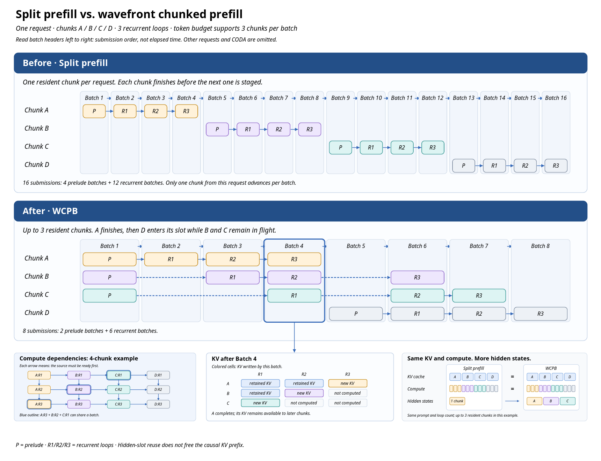

# Split prefill and wavefront chunked prefill

Split prefill limits how much prompt work a request contributes at once.
Wavefront Chunked Prefill Batching (WCPB) uses the same chunk boundary while
batching ready prompt work from different chunks and recurrent depths. Its main
target is better recurrent-core occupancy when prompt batches are sparse or
uneven, without making chunks larger and reducing scheduling opportunities.



The current runner requires one operation per batch: PRELUDE ranges and RECURRENT
ranges are submitted separately. Ordinary prefill can also execute its selected range
through all recurrent depths in one plan. Actual submission counts depend on scheduler
mode, token budget, and ready work; the numbered batches in the figure should not be
read as measured latency or a fixed runtime schedule.

## Execution model

The ordinary path selects a prompt range and runs the range through the
remaining recurrent depths before applying progress. In mixed scheduling, the
scheduler may choose a shorter execution boundary when ready decode work needs a
depth decision. `ExecutionBatch.loop_count` records the recurrent work in that
submission.

With `wavefront_chunked_prefill=True`, prompt work is scheduled in two phases:

| Phase | Work | Recurrent loops in the submission |
| --- | --- | ---: |
| `PREFILLING_PRELUDE` | Embed staged prompt ranges and prepare inputs | 0 |
| `PREFILLING_RECURRENT` | Run ready prompt ranges at their selected recurrent depths | 1 |

The scheduler can include several ranges from different chunks, requests, and
depths in one recurrent batch. It obeys the shared token budget, request-owner
limit, KV capacity, and each depth's readiness frontier. In mixed mode,
compatible decode and prompt work can share PRELUDE or RECURRENT batches. The
batch still contains one operation type.

WCPB is opt-in through `SchedulerConfig.wavefront_chunked_prefill` or the
`--wavefront-chunked-prefill` CLI flag. `prefill_chunk_size` controls the prompt
chunk size. The option works with refill or mixed scheduling; mixed scheduling
does not support speculative work.

## Progress and dependencies

WCPB relies on the depth-specific KV planes of `LAST_EXITED` layout. For
example, a later chunk's depth-0 work can use the completed depth-0 prefix while
an earlier chunk advances at a deeper recurrence depth. A deeper task also
needs its preceding depth's hidden state and the causal KV prefix at its own
depth. The scheduler uses per-depth prompt frontiers to admit only ready ranges.

Progress belongs to the request rather than to a persistent task table:

- `num_preluded_tokens` tracks the prompt range whose prelude has been staged.
- `prefill_depth_ranges` tracks the ready range at each recurrent depth.
- `num_prefilled_tokens` tracks prompt progress at the final depth, including
  progress within a chunk.
- `prefill_reclaimable_tokens` marks the oldest resident chunk boundary. It
  advances only after that chunk completes its final depth and its ring slot
  can be reused.

This separation prevents a prelude or partial chunk from advancing the
reclaimable boundary. Prefix publication, prompt completion, and CODA follow
the completed final-depth frontier.

## Hidden-state ring

Each request reserves `prefill_chunk_size * total_ut_steps` rows for staged
prompt hidden states. A chunk uses a ring slot derived from its index relative
to the cached-prefix origin. For a chunk-local offset `j` and slot `s`, its row
offset is:

```text
prefill_hidden_row_offset = s * prefill_chunk_size + j
```

`ScheduledRequest` and `StateSpan` carry this row offset. When it is `None`, the
runner derives the row from `token_start - chunk_start`. Intermediate outputs
are scattered to the ring for later depths; after final-depth completion, the
chunk's intermediate state is no longer needed. Asynchronous submissions keep
the backing rows alive until dependent reads complete.

## Scheduling and recovery

WCPB advances one recurrent depth per recurrent submission so the scheduler can
regroup the next set of ready ranges. A boundary gives admission and mixed
scheduling a chance to select other work; it does not guarantee that another
request will run. Smaller chunks therefore improve scheduling granularity but
can reduce ordinary prefill occupancy. WCPB tries to recover some occupancy by
batching independent ready chunk/depth ranges.

The implementation uses the existing request queues, `ScheduledRequest`, and
per-depth frontiers; it does not introduce a generic `PrefillTask` registry.
Preemption rewinds staged work to the request's completed prompt frontier and
recomputes unfinished work after resume. PD transfer progress is reported for
completed chunks, and imported prompt state initializes the same frontiers.
Speculative execution is supported with compatible refill scheduling; mixed
mode rejects speculative configuration. CUDA graph and asynchronous paths use
the existing runner machinery.

`SHARED` KV is rejected for WCPB. Its position-major dependencies do not permit
the same cross-chunk/depth ordering as `LAST_EXITED` without a different
scheduler dependency graph.

## Performance and correctness limits

Controlled A100 measurements show that ordinary small chunks can underfill the
recurrent batch. At chunk size 16, one-run WCPB measurements raised rows per
batch and throughput from 64.00 rows and 275.82 tok/s to 254.49 rows and
412.01 tok/s for four 8,064-token requests. For 32- and 128-request mixed
workloads, measured throughput changed from 337.51 to 628.45 tok/s and from
471.95 to 740.29 tok/s respectively. These are directional results from one
warmup and one measured run per variant, not multi-run medians or universal
speedup claims.

A separate HTTP matrix used Ouro-1.4B BF16 with Triton on two A100 80GB GPUs,
`max_num_seqs=8`, `max_num_batched_tokens=1024`, chunk sizes 32 and 128, and
fixed 512-token and variable 256/512/768-token prompts. Each serial, concurrent,
and arrival profile had 100 requests and one measured run. WCPB request
throughput was 0.8% to 22.6% higher than Split in the 12 matched profiles, but
some tail-latency metrics were worse. These measurements do not qualify decode
latency under arbitrary live traffic.

The prior GSM8K-87 BF16 run scored 63/87 for WCPB and 60/87 for Split and
Atomic, but WCPB differed from Split on 24/87 token sequences. The score
difference does not establish output equivalence or improved model quality.
Exact GPU token preservation remains an open validation issue.
