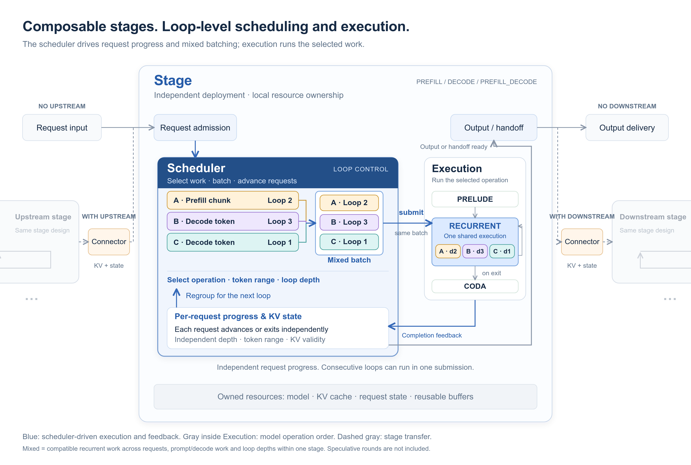
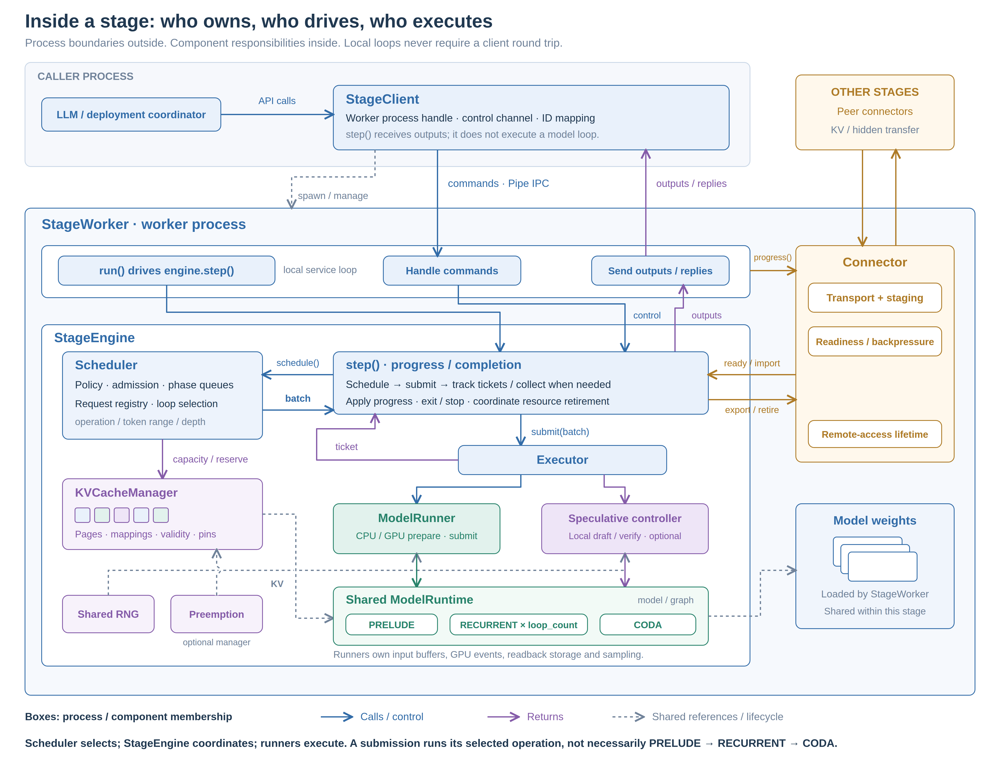
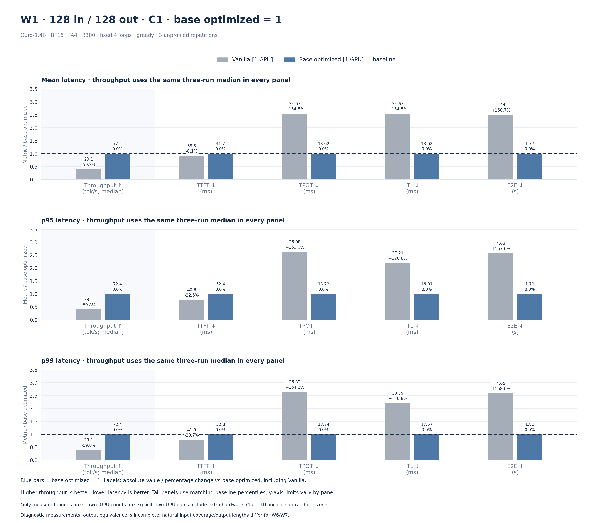
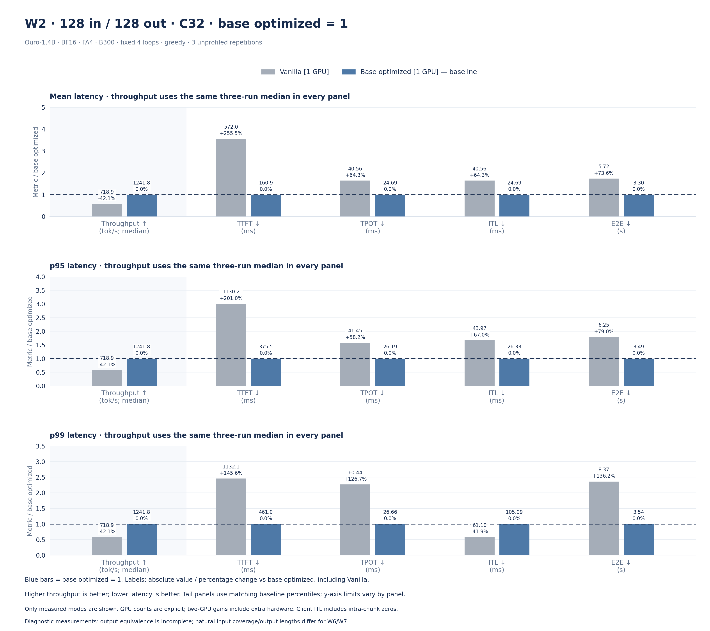
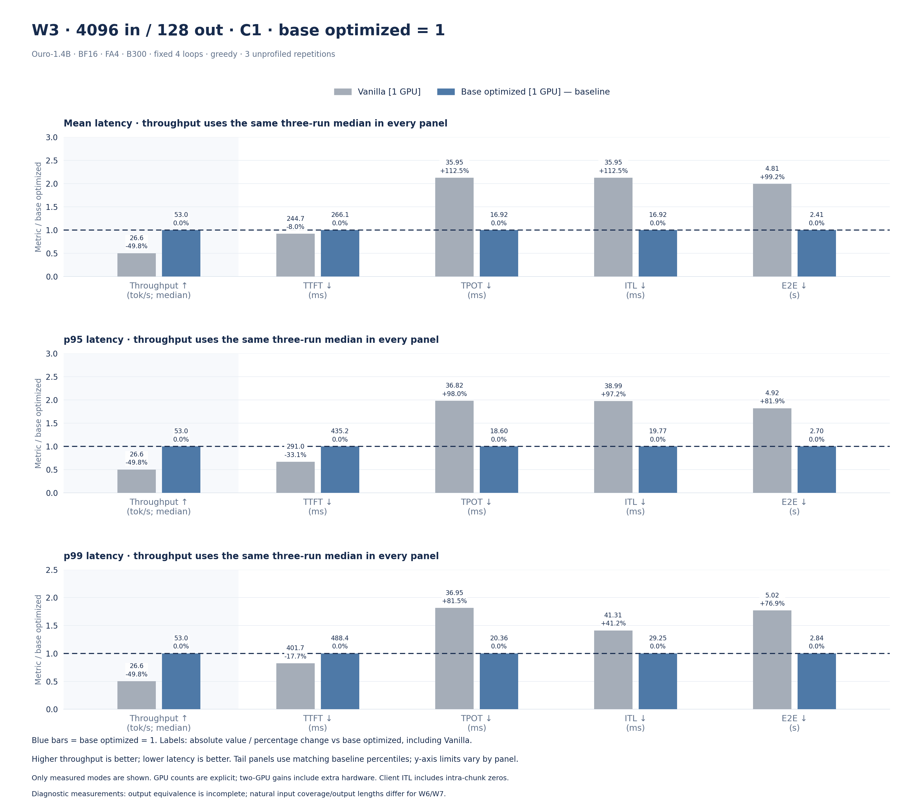
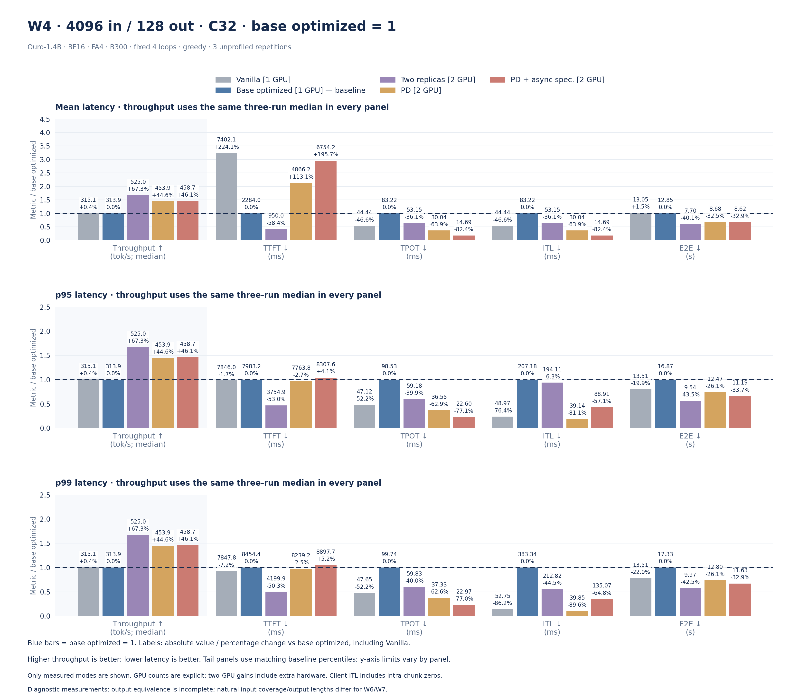
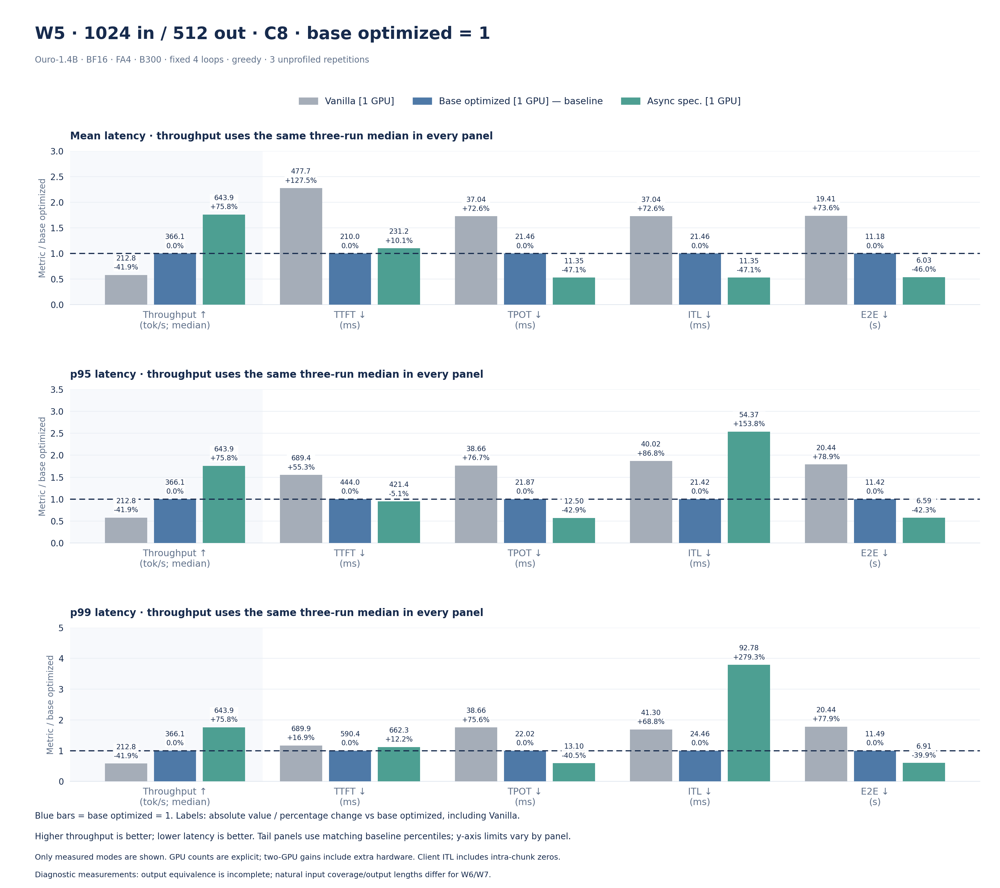
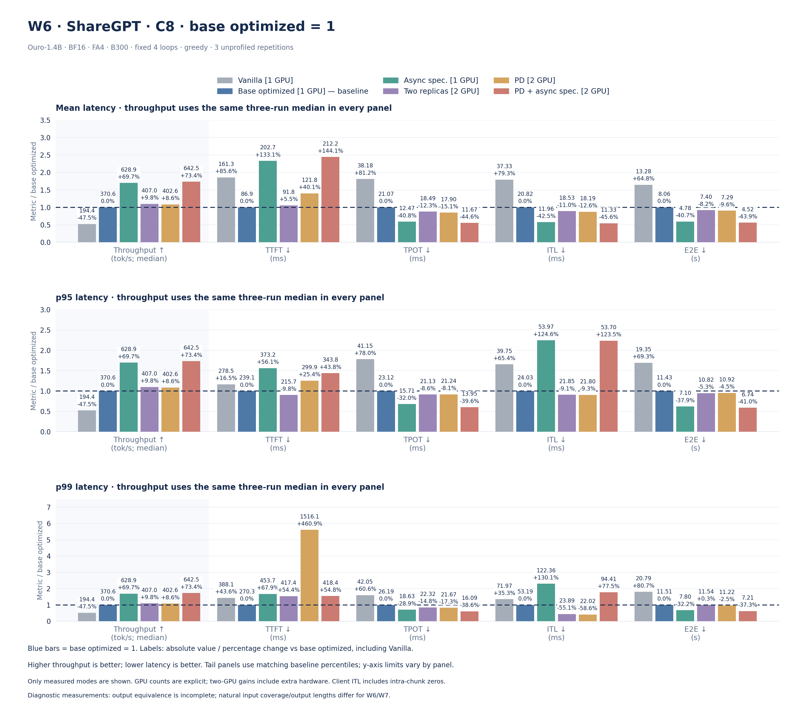
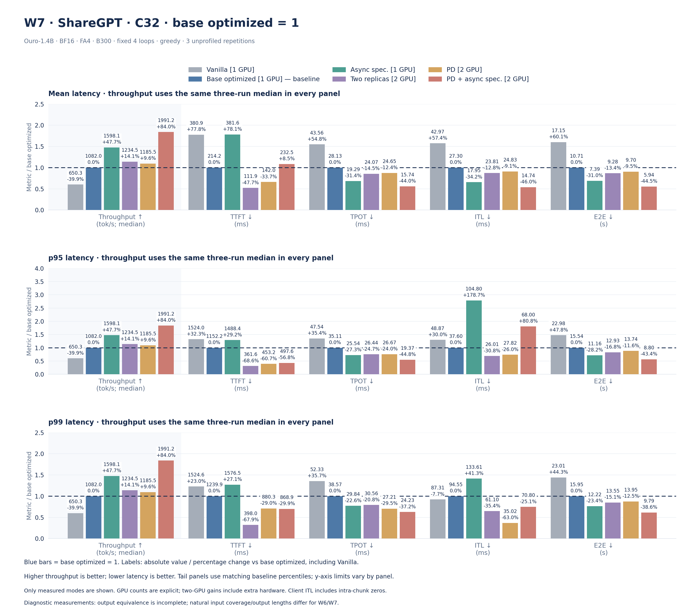

# An inference foundation for loop models

vllm-rlt aims to become both a foundation for executing loop-architecture models
and a collection of engineering knowledge about how to run them well. Its purpose
is to make current models useful while leaving behind implementations, design
reasoning, and evidence that others can build on. A future RSI system or a highly
customized inference engine should be able to draw from this work, whether it
adopts the runtime, reuses a component, or learns from a measured tradeoff.

The starting point is a need for an engine that treats recurrent depth as part
of inference scheduling and state management. Executing a loop model is only
part of that requirement: the engine must also be able to schedule between loops,
combine compatible work, and track KV validity as requests advance through
different depths. In an architecture that keeps these iterations inside an
opaque model forward, exposing them changes assumptions across the scheduler,
execution path, and cache lifecycle. It is a change to the engine's core
contracts, rather than a feature that can be added through a model adapter.
vllm-rlt takes an independent implementation approach so that these contracts can
be designed around loop-level inference from the outset, instead of maintaining
extensive changes across an existing engine's core.

vllm-rlt is an independently implemented inference engine and does not depend on
vLLM. It draws on selected engineering conventions and feature designs from
vLLM, including request scheduling, continuous batching, paged KV management,
chunked prefill, and MRV2-inspired async-first execution and persistent-batch
design. These are references for our own implementation, not a runtime or codebase
that vllm-rlt extends.

These ideas remain valuable for loop models. The additional challenge is that a
token's computation can revisit recurrent layers at successive depths, and
requests can take different paths through those depths. The runtime needs to
represent that progress explicitly so that scheduling and resource management
can make use of it.

## Design philosophy

**Stage is the deployment and resource boundary; loop is the basic unit of
execution and scheduling within a stage.**

Stage ownership remains explicit as prefill, decode, and speculative computation are
arranged across resources; loop-level execution exposes the progress needed for
mixed batching and depth-aware scheduling. We follow an async-first approach:
input preparation and output collection have separate lifetimes, connected by
submission identity and completion events, while persistent device state and
reusable buffers avoid unnecessary reconstruction. A common execution contract
preserves specialized layouts, continuous multi-loop execution, CUDA Graphs, and
stream overlap. Through this independently implemented engine, we aim to build
reusable foundations and practical knowledge for loop models, future RSI
systems, and custom inference engines.

## Why stages and loop-level execution are both needed

PD and speculative inference require flexible placement of computation and clear
resource ownership. Stages let prefill, decode, and speculative computation use
the same local execution machinery across deployment arrangements. Connectors
handle cross-stage state transfer; local draft/verify work can stay within one
stage.

Deployment flexibility alone is insufficient. If recurrent iterations remain
hidden inside a model forward, the scheduler cannot regroup requests between
loops. True loop-level inference exposes each request's operation, token range,
recurrent depth, and KV validity to scheduling and execution. This enables
compatible prefill chunks and decode tokens to share recurrent batches, while
preserving each request's progress and exit decisions. Current mixed batching
uses this capability; it does not include speculative rounds.

Both boundaries are necessary: stage separates resource placement from execution,
while loop-level scheduling makes iterative computation available for batching
and control. Neither requires interrupting every loop. Consecutive loops can run
in one submission, retaining atomic prefill, specialized layouts, CUDA Graphs,
and asynchronous overlap without adding per-loop host synchronization.

## Architecture overview

[Open full-size PNG](diagrams/stage-architecture.png) ·
[Open SVG](diagrams/stage-architecture.svg)

The central stage owns its scheduling, execution, and resources. Optional
upstream and downstream stages connect through connectors; without them, the
stage receives requests and delivers outputs directly.

Inside the scheduler, request A's prefill chunk at loop 2 joins request B's decode
token at loop 3 and request C's decode token at loop 1 in one mixed recurrent
batch. The colors follow each request into shared execution: batching does not
require their phases or loop depths to match. Each request retains its own token
range, depth, and KV state, then advances or exits independently. The scheduler
can regroup the remaining work for the next loop.

PRELUDE and CODA remain separate operations; the illustrated mixing applies to
compatible RECURRENT work, not speculative rounds. Consecutive loops can also
run locally without a host synchronization after every iteration.

The scheduler is the control center: it selects operations, token ranges, and loop
depths, forms compatible batches, and uses per-request progress to decide what
runs next. Execution runs the selected operation. Its arrows show the model's
PRELUDE → RECURRENT → CODA order, including recurrent repetition; they do not
mean every submission runs all three operations.

## Inside one stage

[Open PNG](diagrams/stage-components.png) · [Open SVG](diagrams/stage-components.svg)

Read the outer boundaries first: `StageClient` lives in the caller process;
`StageWorker` runs in a spawned worker process. Inside that worker, `StageEngine`
coordinates local inference, while the optional connector manages transport.
Boxes show component membership, not exclusive ownership of every referenced
tensor. Solid arrows show calls or returns; dashed lines identify shared
references and lifecycle relationships. The `step()` area depicts StageEngine
methods, not an additional controller class.

**Client and worker.** StageClient starts and manages one worker through a
`multiprocessing.Pipe`. It sends requests/control commands, keeps external-ID to
execution-generation mappings and receives outputs/replies. Its `step()` polls
outputs; it does not remotely execute a model loop. StageWorker loads the model,
creates the engine and optional connector, and runs the local service loop:
handle commands, advance transport, call `engine.step()`, send available outputs.
Registering a request and completing its generation are separate events.

**Engine and scheduler.** StageEngine calls Scheduler to select work. Scheduler
owns its local Request registry, phase queues and policy, checks admission/KV
capacity, returns selected operations, token ranges and depths, and applies
per-request progress, exit and termination decisions through
`update_from_output()` and `update_after_submission()`. It does not invoke
ModelRunner. StageEngine submits the returned batch, retains tickets, collects
required `ModelRunnerOutput` results and coordinates runner/connector side
effects and retirement. The engine drives this cycle even when the caller is not
polling outputs.

**Executor and runners.** Engine calls `Executor.submit(batch)`. Executor binds
ordinary work into an execution batch and dispatches it to ModelRunner, or
routes a speculative selection to the local round controller. StageEngine
constructs these objects; Executor references them rather than creating another
model/KV owner. Runners manage preparation, buffers, stream/event dependencies,
execution and result storage; the ordinary runner also handles sampling after
CODA. A returned ticket does not imply device completion. The
[sync vs async speculation timeline](async-speculative.md#timeline-synchronous-versus-asynchronous-speculation)
shows how GPU-owned next-token state lets consecutive rounds overlap result
readback and CPU commit within this same stage.

**Pipelined speculation (experimental).** `--speculative-mode pipeline` reuses
the shared speculative runner to advance tokens at different recurrent depths.
See [pipelined self-speculation](async-speculative.md#pipelined-self-speculation)
for configuration, state lifetimes, and token-level acceptance/rejection diagrams.

**Shared execution and resources.** ModelRunner constructs ModelRuntime and the
speculative controller references that same runtime. Both use the worker-loaded
model, the engine's KV manager and shared RNG registry. The runtime executes the
selected PRELUDE, RECURRENT or CODA operation; the three labels are alternatives,
not a mandatory three-step sequence in each submission. A submission can include
multiple recurrent loops. Packed prefill, persistent decode buffers, graph replay
and optional stream overlap remain execution choices behind this interface.

| Resource / mechanism | Owner or coordination boundary |
| --- | --- |
| Worker process, channel and host-side ID mappings | StageClient; connected workers are coordinated by the deployment host |
| Loaded model and local service loop | StageWorker; the engine and runners reference the same loaded model |
| Request registry, phase queues and selection policy | Scheduler; StageEngine coordinates lifecycle, pending tickets and runner/connector side effects |
| KV pages, mappings, validity and references/pins | KVCacheManager, shared by local scheduling and execution |
| RNG registry and pending results | StageEngine; runners use the shared RNG, and tickets retain their result storage |
| Input buffers, GPU events and readback storage | Runner/controller owners, retained until consumers finish |
| Preemption snapshots | Engine-owned PreemptionManager, invoked through scheduler callbacks |
| Transport staging and remote-access lifetime | Connector; local Request/KV changes are coordinated through StageEngine |

**Model configuration.** Deployment entry points construct a shared `ModelConfig`
from the resolved checkpoint JSON, an existing concrete config, or `module.config`
before spawning workers. It retains the concrete model config and delegates common
request limits, including derived properties. StageClient and the PD coordinator
retain it; spawned workers receive copies. Checkpoint workers load weights using
the concrete config without reparsing JSON; config-only inputs construct models,
and module inputs retain their supplied weights. Models and StageEngine continue
to use the concrete config. Configuration is treated as read-only after initialization.
Worker `ready` messages report runtime capacity and transport information, not a
serialized model config. PD still verifies worker-computed weight/KV fingerprints
before connecting peers; static configuration does not prove runtime compatibility.
PD validates model-family support before spawning workers and explicitly rejects
unsupported families.

**Connector and deployment.** Worker calls `connector.progress()` independently
of engine progress. Connector readiness/backpressure reaches Scheduler through
the engine's readiness predicate. Import/export and safe release also coordinate
with the engine; KV/hidden transport between peer connectors is distinct from
Client/Worker control messages. The drawing shows those two communication paths
separately. Detailed data movement is in the [stage handoff diagram](scheduler.md#3-request-handoff-between-reusable-stages).

`prefill_decode`, `prefill` and `decode` use this same worker/engine structure.
For PD, the deployment coordinator manages multiple StageClients and connectors;
loop scheduling stays local. Mixed is a batching policy, and speculation is an
optional local round controller, not another deployment role. Current mixed
batches do not include speculative rounds. The launcher currently supports single
stages and same-host PD GPU pools; other compositions require additional deployment
support. See [runtime compatibility](runtime.md#execution-batches-and-mixed-scheduling).

`LLMEngine` is currently a compatibility alias for `StageEngine`, not another
layer. An entrypoint variable named `engine` can hold a StageClient; the diagram
uses concrete component names to avoid confusing that proxy with the local engine.

Code: [StageClient](../vllm_rlt/engine/llm_engine.py),
[StageWorker](../vllm_rlt/engine/worker.py),
[StageEngine](../vllm_rlt/engine/stage_engine.py),
[Scheduler](../vllm_rlt/core/scheduler.py),
[Executor / ModelRuntime](../vllm_rlt/worker/executor.py),
[ModelRunner](../vllm_rlt/worker/model_runner.py), and
[connector contract](../vllm_rlt/engine/connector.py).

## Measured serving performance

The October 2026 campaign compares Vanilla (unoptimized) execution, base optimizations,
asynchronous self-speculation, two independent replicas, PD, and PD with
asynchronous speculation. It measures the combined configurations below; it does
not isolate the contribution of individual optimizations or qualify every
architecture feature described above.

### Protocol and comparison rules

- **Model and hardware:** Ouro-1.4B, BF16, FlashAttention 4, B300, fixed four
  loops, greedy decoding. Single-stage modes use one GPU; replicas and 1P1D use
  two. No more than four GPUs were used concurrently during the campaign.
- **Measurement:** three unprofiled repetitions per combination. Each repetition
  uses 60 seconds of closed-loop admission followed by drain. Output throughput
  includes the drain period and is summarized by the median. All selected
  windows have zero new CUDA Graph captures. This is not a saturation sweep.
- **Chart baseline:** base optimized is **1 for every metric and statistic**.
  All other bars, including Vanilla, are divided by the matching base-optimized
  value in the same workload. Change = `(candidate / baseline - 1) × 100%`.
  Higher throughput and lower latency are better. Two-GPU comparisons against
  the single-GPU base include the hardware increase. The
  interpretation below uses paired comparisons: base optimized
  vs Vanilla, then other candidates vs base optimized; their denominators are
  explicitly distinguished from the new plots.
- **Latency:** TTFT is client send to first output; TPOT is first-to-last output
  time divided by `N - 1`; E2E is client send to response completion. Their mean,
  p95 and p99 pool successful requests across repetitions. Client token-arrival
  ITL pools all adjacent token intervals: tokens in one received chunk share a
  timestamp, so intra-chunk intervals are zero. It excludes TTFT and never joins
  requests. ITL is client delivery timing, not internal per-token compute time.
  Mean TPOT weights requests equally; mean ITL weights intervals equally.
- **Data:** W1–W5 use fixed lengths with EOS ignored. W6/W7 replay a fixed,
  seeded selection of 256 ShareGPT first-human messages, without a chat template,
  using natural EOS and an output cap of 512. Faster configurations cover more
  inputs during the same admission window; actual input/output lengths differ.
- **Qualification:** 26 combinations, 78 selected runs, 12,288 successful
  requests, zero request failures. Full greedy output equivalence has **not**
  passed across all configurations. Bounded diagnostics found batch sensitivity
  and one BF16 logit tie; these do not explain all mismatches. Performance is
  diagnostic, not an equal-quality speedup or production acceptance result.

| Configuration | GPUs | Execution |
| --- | ---: | --- |
| Vanilla | 1 | Synchronous, no-refill; async execution, multi-stream, static buffers, padding, UVA, packed prefill and CUDA Graphs disabled |
| Base optimized | 1 | Async scheduling, refill, multi-stream, static buffers, padding, UVA, packed prefill and CUDA Graphs enabled |
| Async spec. | 1 | Base execution optimizations plus asynchronous self-speculation: draft depth 2, target depth 4, K=4 |
| Two replicas | 2 | Two independent base-optimized servers; total concurrency split equally |
| PD | 2 | One prefill worker and one decode worker, using base optimizations |
| PD + async spec. | 2 | 1P1D with asynchronous speculation on the decode worker |

The scheduler limit is 32 requests and 1,024 tokens; prefill chunks are 1,024
tokens. KV capacity is 40,000 blocks × 16 tokens. Prefix caching, preemption,
incremental KV allocation and adaptive early exit are disabled. Atomic prefill
executes all recurrent loops for one chunk, not the entire long prompt at once.
Base optimized uses `ouro_delayed`; Vanilla and speculation use `ouro` with fixed
four target loops.

| Workload | Input tokens | Output tokens | Concurrency |
| --- | ---: | ---: | ---: |
| W1 | 128 | 128 | 1 |
| W2 | 128 | 128 | 32 |
| W3 | 4096 | 128 | 1 |
| W4 | 4096 | 128 | 32 |
| W5 | 1024 | 512 | 8 |
| W6 | ShareGPT, natural lengths | Natural EOS, cap 512 | 8 |
| W7 | ShareGPT, natural lengths | Natural EOS, cap 512 | 32 |

### Full comparison: baseline = 1, absolute values and changes

Each workload has one figure combining **throughput, TTFT, TPOT, ITL and E2E**.
Its three panels show **mean, p95 and p99 latency**. Throughput is the same
three-run median in every panel; it is not a p95/p99 throughput measurement.
The blue base-optimized bars are always exactly **1**. All other configurations,
including Vanilla, use this same baseline. Thus a bar at 1.7 means 70% above the
base-optimized value, and a bar at 0.6 means 40% below it.

Every bar, including the baseline, has two label lines: **absolute value**, then
**percentage change**. Units are printed below the metric: tok/s for throughput,
ms for TTFT/TPOT/ITL, and seconds for E2E. Bar heights show ratios, not absolute
units. Higher throughput is better; lower latency is better. Y-axis limits vary
between panels to preserve large regressions without clipping them.

Only measured configurations are plotted. All 26 measured combinations remain
visible; Vanilla is included in both this full view and the README. Vanilla
corresponds to the `plain` identifier in the original benchmark records.
Percentiles pool samples across repetitions, rather than
averaging per-run percentiles; small-sample tails are descriptive only.

#### W1: 128 input / 128 output · concurrency 1

[Full-size PNG](assets/performance/core-w1-comparison.png)

#### W2: 128 input / 128 output · concurrency 32

[Full-size PNG](assets/performance/core-w2-comparison.png)

#### W3: 4096 input / 128 output · concurrency 1

[Full-size PNG](assets/performance/core-w3-comparison.png)

#### W4: 4096 input / 128 output · concurrency 32

[Full-size PNG](assets/performance/core-w4-comparison.png)

#### W5: 1024 input / 512 output · concurrency 8

[Full-size PNG](assets/performance/core-w5-comparison.png)

#### W6: ShareGPT · concurrency 8

[Full-size PNG](assets/performance/core-w6-comparison.png)

#### W7: ShareGPT · concurrency 32

[Full-size PNG](assets/performance/core-w7-comparison.png)

### Two-GPU resource efficiency

The main comparison plots normalize every configuration to single-GPU base
optimized.
The table below additionally exposes per-GPU throughput and lets readers
compare ordinary replicas and PD using the same two-GPU budget. Both deployment
forms receive the same total concurrency; replica concurrency is split equally.

| Workload | Configuration | GPUs | Total output tok/s | Output tok/s/GPU |
| --- | --- | ---: | ---: | ---: |
| W4 | Base optimized | 1 | 313.9 | 313.9 |
| W4 | Two replicas | 2 | 525.0 | 262.5 |
| W4 | PD | 2 | 453.9 | 226.9 |
| W4 | PD + async spec. | 2 | 458.7 | 229.3 |
| W6 | Base optimized | 1 | 370.6 | 370.6 |
| W6 | Two replicas | 2 | 407.0 | 203.5 |
| W6 | PD | 2 | 402.6 | 201.3 |
| W6 | PD + async spec. | 2 | 642.5 | 321.2 |
| W7 | Base optimized | 1 | 1,082.0 | 1,082.0 |
| W7 | Two replicas | 2 | 1,234.5 | 617.2 |
| W7 | PD | 2 | 1,185.5 | 592.7 |
| W7 | PD + async spec. | 2 | 1,991.2 | 995.6 |

PD alone does not exceed ordinary two-replica throughput in these three cases.
At C8, PD + speculation adds little throughput over single-GPU speculation;
at C32 its throughput is higher, but does not scale in proportion to GPU count.
Two independent speculative replicas were not measured, so this campaign does
not identify the best possible two-GPU deployment.

### Workload interpretation and evidence

| Case | Interpretation |
| --- | --- |
| W1 | Base optimization improves throughput 149.0% and mean E2E 60.1%; TTFT is slightly higher. |
| W2 | Throughput improves 72.7% and mean E2E falls 42.4%, but ITL p99 rises 72.0%. Common-input first-sample token equality is 49/64 for base optimized vs Vanilla. |
| W3 | Throughput improves 99.2% and mean E2E falls 49.8%; TTFT increases, especially p95. |
| W4 | Base throughput is flat and generation intervals worsen. Two replicas have the highest measured throughput; PD smooths generation but adds first-token wait. All tested candidate modes match Vanilla on the 64 common-input first samples checked. |
| W5 | Async speculation adds 75.8% throughput over base optimized and lowers mean E2E 46.0%, with worse ITL tails. Its common-input first-sample equality is 30/32 vs Vanilla. |
| W6 | Single-GPU speculation adds 69.7% throughput and lowers mean E2E 40.7%, at higher TTFT and ITL tails. The second GPU has limited throughput return; PD TTFT p99 reaches 1,516 ms. |
| W7 | Async speculation adds 47.7% throughput; PD + speculation adds 84.0%, using two GPUs. Base optimization itself raises ITL p99 by 8.3%; real-output lengths and coverage differ across modes. |

Percentage comparisons in this interpretation use base optimized vs Vanilla,
then other modes vs base optimized. In the plots, Vanilla is instead shown
relative to base optimized; inverse comparisons have different percentages.
Output-equality checks cover shared inputs' first samples only; they are not
task accuracy scores.

Measurements used a frozen working tree based on
`c3ce15540d57893abb92b01f090c26659ebdf21c` **with local modifications**;
the HEAD alone does not identify the measured runtime. Original measurements
and checks are retained in the local `experiments/core-perf-20261021` campaign.
Earlier PR #30/#31 measurements use different workloads and timing boundaries
and are not mixed into these charts.

## Where the details live

| Question | Guide |
| --- | --- |
| Which loops can share a batch, and when does a request wait? | [Loop-level scheduler](scheduler.md) |
| How are inputs prepared, transferred and executed? | [Runtime execution and configuration](runtime.md) |
| Which KV history does a loop read, and who retains it? | [Model semantics](design.md) and [KV management](kv_cache_walkthrough.md) |
| How do draft/verify rounds advance asynchronously? | [Sync vs async timeline](async-speculative.md#timeline-synchronous-versus-asynchronous-speculation) |
| How do I launch and serve a configuration? | [First-run guide](launching.md) and [HTTP serving](serving.md) |
